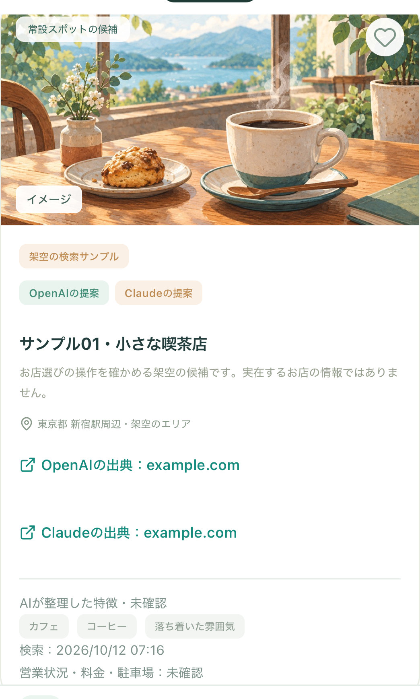
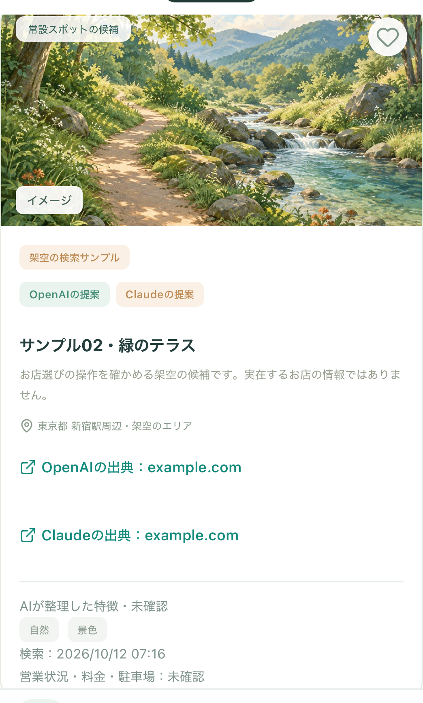
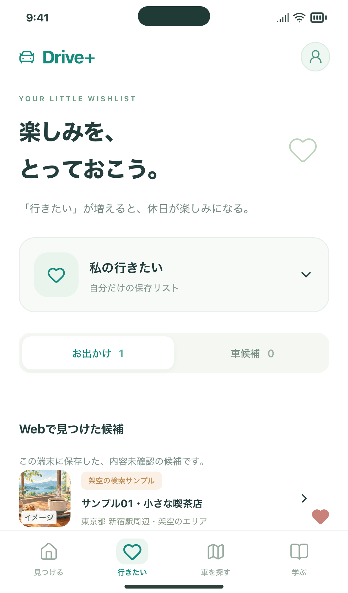
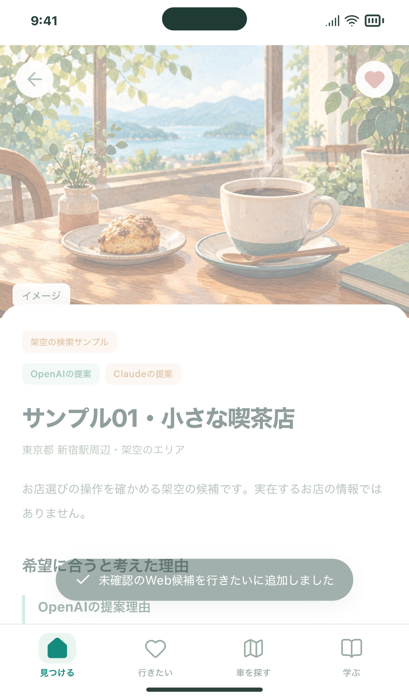
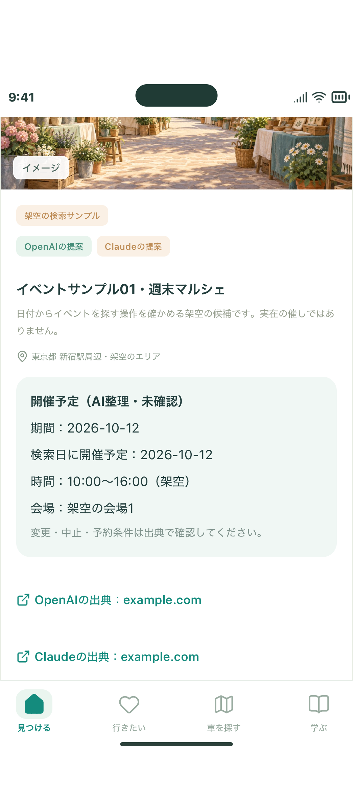

# おすすめ・イベントのカードにイラストを表示（#116）

写真未取得の空欄に、カフェ・食事・自然・アート・イベント・お出かけ共通の6種類のイメージイラストを表示します。既存のカード幅、高さ、ハート、出典、保存・詳細への操作は維持します。

## 確認する3操作

1. 見つける→「前回の比較結果を開く（無料）」。カードの分類に応じたイラストが表示されることを確認します。新しい検索は不要です。
2. 気になる候補を保存→行きたい→詳細。同じイラストが表示され、再読み込み後も保存が残ることを確認します。
3. イベントの結果や共有候補でもイラストが表示されます。共有候補は共通イメージです。

| おすすめ | 自然 |
| --- | --- |
|  |  |

| 保存した候補 | 詳細 |
| --- | --- |
|  |  |

画像はすべて架空サンプルでの動作確認です。カードの「イメージ」は、実際の店舗・会場・メニューの写真を取得したという意味ではありません。

## 表示のルール

- 取得済みのジャンルから画像を選びます。いいねや好きな理由を変更しても絵は変わりません。
- イベントはイベント用、ジャンルのない旧保存は共通のお出かけ用です。推測した店舗写真や外部画像URLは使いません。
- 共有リストには分類や個人の好みを追加送信しません。共有候補は共通イラストを表示します。
- 読込失敗時は共通イラスト、さらに失敗したときは地図アイコンに切り替えます。カードの寸法や保存・詳細操作は維持します。
- 保存データや検索APIの形式に画像を追加しないため、移行・再検索は不要です。

## 素材と費用

[最終画像の保存先](../../../public/images/spot-illustrations/) / [生成プロンプト一式](../../assets/spot-illustrations-prompts.json)。内蔵image_genを使用し、プロジェクトのOpenAI・Anthropic検索キーは使っていません。6点のJPEGをアプリに同梱し、表示時の画像生成課金はありません。検索APIの累計5回上限や課金方式は従来どおりです。

## 検証

PC Chromium／スマホWebKitでカフェ・自然・イベントの画像読込、保存→詳細→再読み込み時の同一画像、画像失敗時の代替表示、横幅崩れなし、JSエラーなしを確認。既存の検索フロー48件でも保存・詳細などの操作を検証し、すべて成功しました。実際の検索API呼び出しは0回です。

公開版・iPhone 17 Simulator・CIの最終結果はIssueとPRのコメントに記録します。実機iPhoneでの今回の表示は未確認です。
