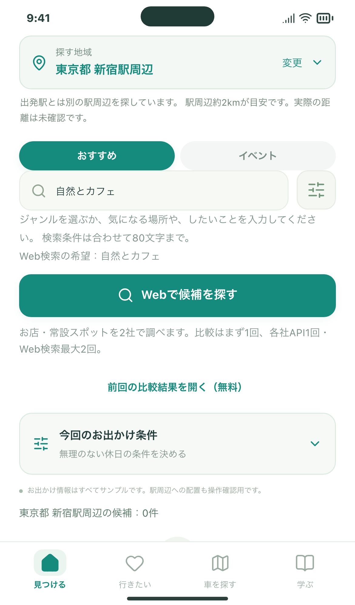
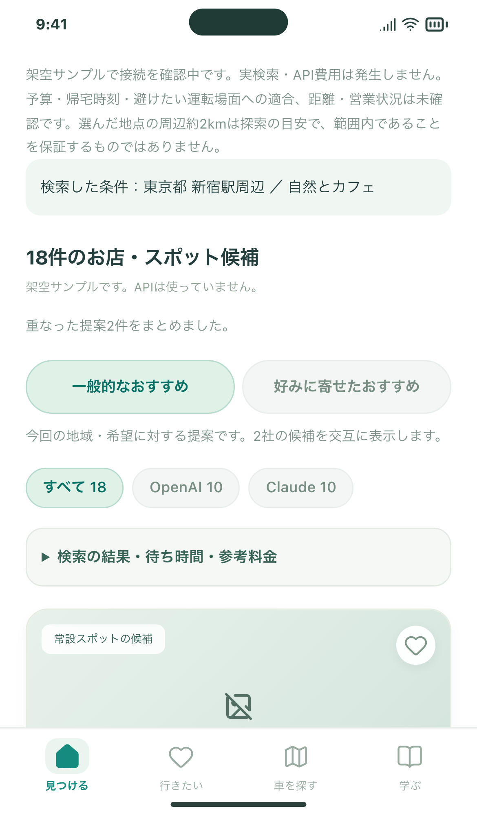

# 「見つける」の入力・説明欄を整理（#114）

「探し方」の選択欄と「いいねはどう使われる？」の説明欄を削除しました。検索はOpenAI・Claudeの比較を使い、保存・好きなところ・好み順・出典・詳細は引き続き使えます。

## 確認する2操作

1. 見つけるで駅または現在地を指定し、ジャンル・希望を入力します。探し方の選択欄を挟まずに検索ボタンへ進めます。イベントも同様です。
2. 取得済み結果を無料で開き、保存・好み順・詳細を操作します。「いいねはどう使われる？」は表示されません。

| 条件入力 | 結果・並び順 |
| --- | --- |
|  |  |

画像は無料のローカルサンプルです。実際のお店の検索やAPIへの送信は行っていません。公開版の累計5回上限、保存データ、送信項目、課金方式は変更していません。旧京都検索は独立したローカル検証ツールに残し、既存の保存候補も消しません。

## 開発側の確認

- 型チェック・ビルド、PC幅Chromium／スマホ幅Chromium・WebKitでの検索操作を検証。
- 無料サンプルの18件表示、出典、保存・解除、好み順、詳細、再読込後の復元を確認。
- 駅未指定・空欄・上限・通信失敗・0件・応答不整合での動作、保存データ維持、連打で追加送信しないことを確認。
- テストの旧検索用の操作を比較検索へ移行。比較検索用の空表示に期待文言を合わせた後、該当21ケース成功。他の比較・イベント27ケースも成功。

CI・公開版・iPhone 17 Simulatorの最終結果はIssue／PRコメントに記録します。実機iPhoneは今回未確認です。
