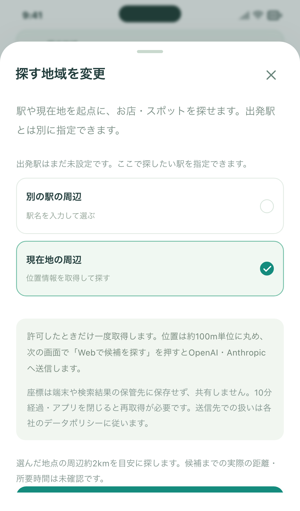

# 現在地から探す・1アカウント累計5回（Issue #110）

2026-10-25追記：「見つける」の一時的なタブ・アプリ切り替えでは、位置の10分間の期限を延長せず検索を維持するよう変更しました。以下は導入時の検証記録です。現在の起動時検索・回数制限・位置の扱いは[ドライブ検索のガイド](../../DRIVE_DISCOVERY.md)を参照してください。

## 試す操作

1. 「見つける」→「探す地域」→「現在地の周辺」→「現在地を取得して設定」。許可すると「取得した現在地の周辺」になります。出発駅は変わりません。
2. ジャンルを選ぶか希望を入力し「Webで候補を探す」。位置取得だけでは検索しません。周辺約2kmは探索の目安で、候補までの距離は未確認です。
3. 検索結果欄に累計回数・残り回数が表示されます。5回目までは検索でき、6回目は止まります。前回の結果・行きたいの閲覧は上限後も使えます。

位置取得の説明：

## 保存・料金

- 新しい比較検索（OpenAIとClaudeの1セット）を1回と数えます。過去の利用・送信後の失敗も含め累計5回。日次リセットなし。同じFirebaseアカウントならWeb・iPhoneで共通です。
- アカウントUID単位であり、一人による複数アカウント作成を検出する仕組みではありません。参加コードと運営の停止スイッチは維持します。
- 座標は小数点3桁（約100m単位）へ丸め、明示検索時のみ2社へ送ります。端末の永続保存、共有リスト、D1とローカル検証の保存結果には検索中心の座標を入れません。近くの駅は地理的な手掛かりとして添え、中心は取得した位置のままです。
- 位置は10分、背景移行、終了、再起動で破棄。取得失敗時は駅検索へ戻れます。過去の候補から検索地域は推測可能です。送信先各社の処理は各社のデータポリシーに従います。
- 1人5回の制限はサービス全体の料金上限ではありません。総額3,000円の予算方針を維持し、新しい有料インフラ・地名変換APIは追加していません。

## 開発側の確認

- ブラウザ：PC、スマートフォン幅のChromiumとWebKitで、明示取得・駅切替・出発駅保持・拒否・精度不足・古い位置・取得取消・10分期限・背景移行・再読み込みを確認。
- 検索接続：架空APIを使い現在地＋ジャンル→カード→保存→詳細／前回結果、座標なしの復元を確認。公開検索のFirebase認証はエミュレーターで確認。
- サーバー：SQLiteと実WorkerランタイムのローカルD1で、5回目・6回目・同時実行・既存9回の台帳保持・失敗の計数・7日期限・無料復元・別ユーザー分離・異常座標拒否を確認。
- iPhone 17シミュレーター：実Capacitor Geolocation＋WKWebViewで新宿駅の模擬位置を取得し、ジャンル検索のログイン確認まで操作。再起動で位置が残らないことを確認。実ユーザーの場所は検証記録へ載せません。
- 有料APIへの検索送信は0回。実際の候補の精度や実機GPSでの最終確認は依頼者の操作で確認してください。

CI、公開先、最終ビルド番号、実行ログへのリンクはIssue #110／PRのコメントに追記します。PR #105に依存し、先に#105をマージした後にこのPRを更新・再検証する順序です。

API仕様確認：[OpenAI Web search](https://developers.openai.com/api/docs/guides/tools-web-search)。位置は検索条件として既存リクエストへ渡し、検索ツール・モデル・各社最大2検索は維持します。端末内の駅データから参照駅を求めるため追加の外部APIは使いません。
