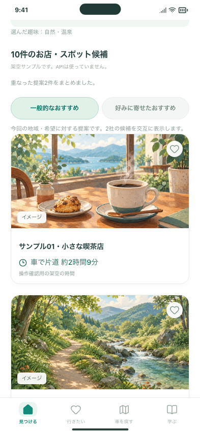

# 起動時のおすすめ検索とシンプルなカード

2026-10-21・Issue #126 / PR #125。前回の手動検索・累計6回の確認手順を置き換えます。

## 試す操作

実API版（このMacのみ）: http://127.0.0.1:5211/#/

1. ホームを開きます。初期設定が未完了なら趣味を選び、位置情報の許可が出たら許可します。現在地＋趣味で一度自動検索し、候補が並びます。取得できない場合は「出発地を選ぶ・変更する」で駅を選べます。
2. 画像・場所名・車の片道時間が並ぶカードをタップします。説明・出典・イベント日付・未確認項目を詳細画面で見られます。ハートで保存できます。
3. 詳細から戻る、行きたい・学ぶとホームを往復します。新しい検索は増えません。ブラウザ再読み込みやアプリの新しい起動では再度自動検索します。

検索回数の上限はありません。新しい検索にはAPI料金が発生します。公開Web・インストール済みiPhoneには未反映です。コードは同じPRで確認待ち、マージしていません。

## 確認結果

- 無料の画面テスト60件：PC、スマホ幅Chromium、スマホ幅WebKitで、自動起動・初期設定の趣味・拒否時の駅選択・再起動・保存・詳細・自由入力・条件・イベント検索を確認。
- 無料のサーバーテスト43件：既存台帳を保持して旧上限を超える検索、再起動、同時実行防止、失敗時に勝手に再試行しない動作を確認。旧単独調査ツールの独立した制限も維持。
- 公開検索サーバーのローカルテスト13件、認証エミュレーターと画面のテスト9件：5回を超える検索、Web/iPhone用Origin、利用履歴・アカウント分離・保存の維持を確認。公開サービスへ送信・デプロイしていません。
- 実APIは1検索だけ実施。検証用の現在地は新宿駅、趣味は自然・温泉。OpenAI・Anthropicに各1リクエスト、Google Routesで計算。6カードのうち5件に計算時間、1件に未確認を表示。両社とも応答しましたが、Claudeは出典などの検査を通過する候補が0件でした。
- 実API画面で保存・詳細・戻る・学ぶタブとの往復を行い、検索POSTは合計1回。端末保存に座標・Googleの時間や距離を含めないこと、提案元フィルターと料金欄がないことも確認。[Googleの経路数値を含まない検証集計](live-check.json)

実API結果の全施設の営業状況や正確な車の入口、実機GPS、API請求明細は未確認です。10件は目安で、情報が足りない場合に架空の候補を追加しません。

## 画面

以下は有料検索を使わない架空サンプルです。時間・場所は操作検証用で、実際の経路ではありません。

[PC幅のカード](cards-desktop.png) / [ホーム上部](home-mobile.png) / [詳細画面](detail-mobile.png)

[送信内容・費用・設定の手順](../../DRIVE_DISCOVERY.md)
