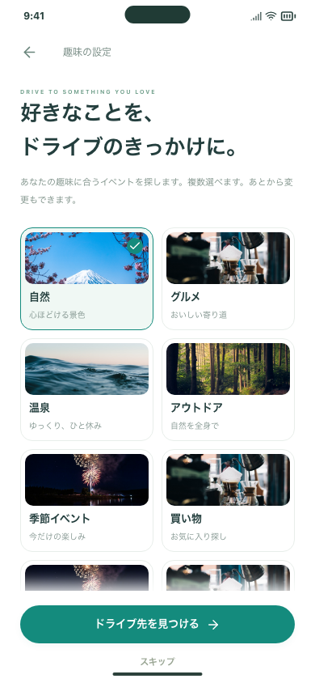
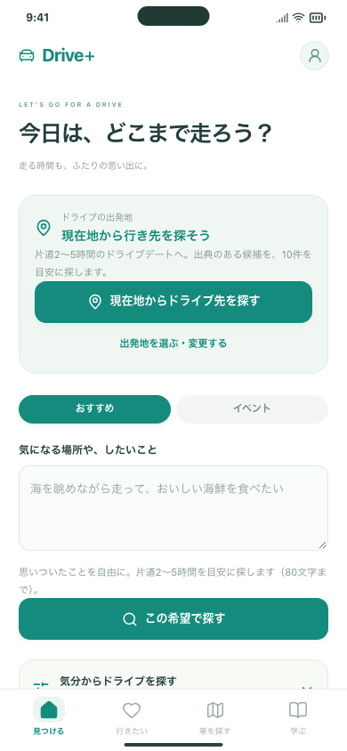
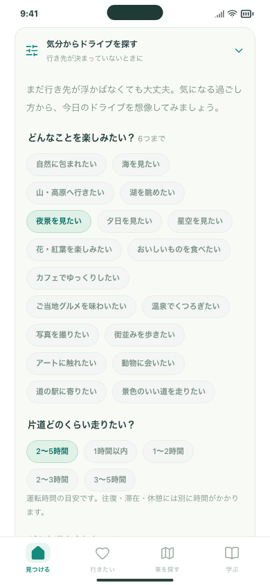
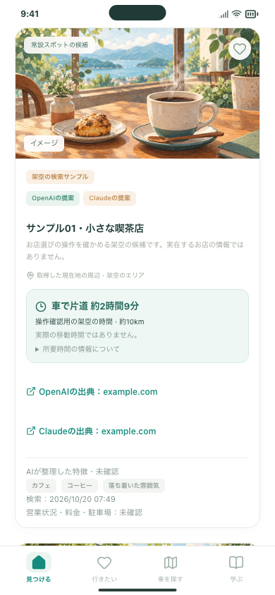
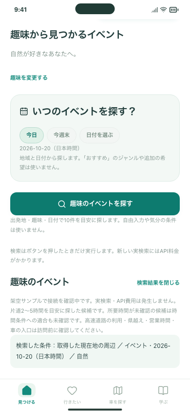

# 趣味から始めるドライブのホーム（#124・#126）

最初の設定を趣味選択にし、ホームを現在地起点のドライブデートへ変更しました。自由入力・気分の条件・趣味のイベントを独立して探せます。同行者・出発駅の初期質問、ラーメン診断、旧ジャンル絞り込み、前回結果ボタンはありません。

[試す3操作・キー準備・保存と費用への影響](../../DRIVE_DISCOVERY.md)

| 趣味の初期設定 | 現在地から始めるホーム |
| --- | --- |
|  |  |

| 気分から選ぶ | 所要時間つきカード |
| --- | --- |
|  |  |

画像は390×844、架空サンプルによる確認です。現在地のテスト入力は公共の目印（新宿駅）で、利用者の実際の位置ではありません。Google・OpenAI・Anthropicへの実通信はしていません。

## 開発側の確認

- PC Chromium・スマホ幅Chromium・スマホ幅WebKitで、趣味、GPS、4検索、保存・詳細・戻る・再読み込みを確認。
- 自由入力と気分条件が混ざらず、イベントには趣味と日付が送られることを確認。
- Matrixの失敗・未設定・時間範囲・並び違い・不正な応答を架空応答で確認。
- 保存・共有・サーバーの保管結果にGPS座標・経路計算結果を残さないことを確認。
- Firebase Authエミュレーターで参加・アカウント切替・累計5回を確認。
- GitHub CIの最終結果はPR #125とIssue #126に記録。

実機と実APIはキー準備後の確認事項です。mainへのマージ・公開・既存iPhoneの更新は未実施です。
