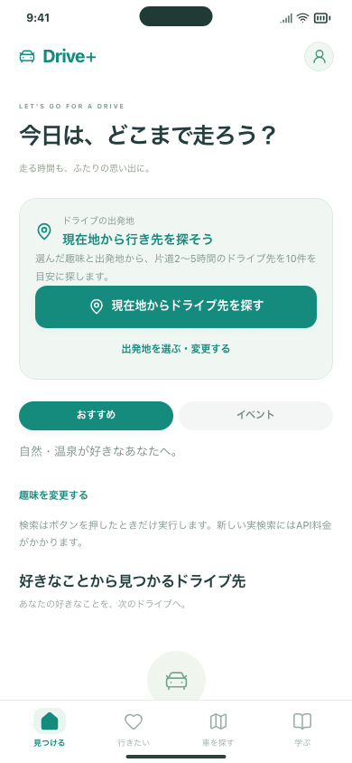
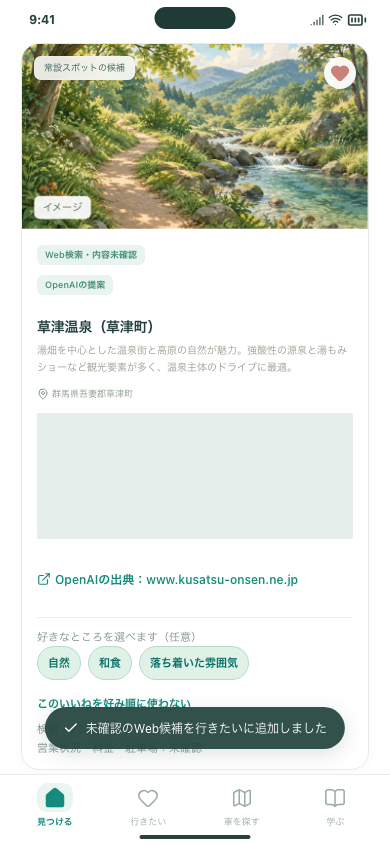

# 趣味から見つかるホームと実APIの確認

Issue #126 / PR #125。2026-10-20。

## 試す3操作

実API確認URL： http://127.0.0.1:5211/#/welcome （このMacのみ）

1. 「はじめる」→趣味を選ぶ→「ドライブ先を見つける」。ホームにも選んだ趣味が表示されます。
2. 「現在地からドライブ先を探す」→内容を確認→「現在地を取得して検索」。取得と検索のあと、趣味に合うカードが自由入力より上に並びます。位置が取得できなければ出発駅を指定できます。
3. パネルの所要時間・出典を確認し、保存→詳細→戻るを試します。趣味を変更すると「前回の検索結果」の案内が出て、再検索はボタンを押したときだけです。

サンプル版は http://127.0.0.1:5210/#/welcome 。5211番の新しい検索には実API料金が発生します。既存の利用1回を維持して5回追加し、開発確認に1回使用。確認直後は累計2/6回、残り4回です。公開版・iPhoneには未反映です。

## 確認した結果

- 無料テスト：趣味が両社の検索へ渡ること、自由入力・条件と混ざらないこと、趣味変更・タブ切替・再読込で勝手に再検索しないこと、枠の使い切り・サーバー再起動でも回数を維持すること。
- 実検索：新宿駅の座標をブラウザの検証用現在地として使用。実機GPSではありません。「自然・温泉」で1回検索し、両社が完了。出典検査後の候補はOpenAI 7件・Claude 2件。片道時間の範囲外5件を除き、4件を画面表示しました。Googleの所要時間は4件とも取得できました。
- 保存・詳細・戻る・タブ切替を確認し、追加の検索は0回。端末保存・サーバー保管に位置とGoogleの時間・距離を含めないことを確認しました。
- 実検索時、AI紹介文に独自の移動時間が入る例が見つかったため、その文を除く処理を追加。合成データのテストで確認し、実APIは再実行していません。
- 正確な車の到着場所・営業状況・趣味との一致度・実請求は、人が出典や管理画面で確認する項目です。約10件は目標であり、情報不足を架空候補で補いません。

[実確認の集計](live-check.json)

[PC表示の確認画像](home-desktop.png)

Googleの経路数値をリポジトリへ残さないため、画像では時間欄だけマスクしています。実際の画面では計算時間とGoogle Maps表記を確認しています。写真部分は既存のイメージイラストです。

[設定・再起動の手順](../../DRIVE_DISCOVERY.md)
