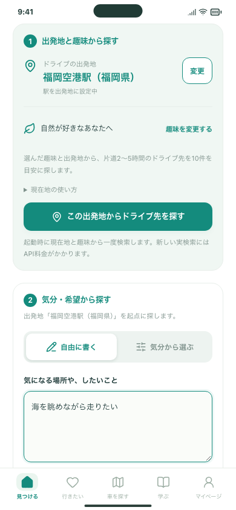
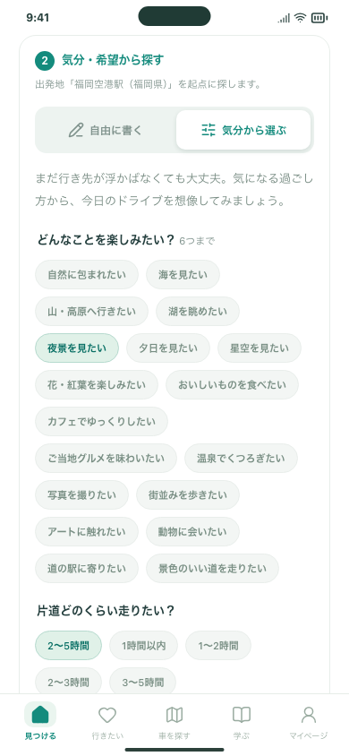
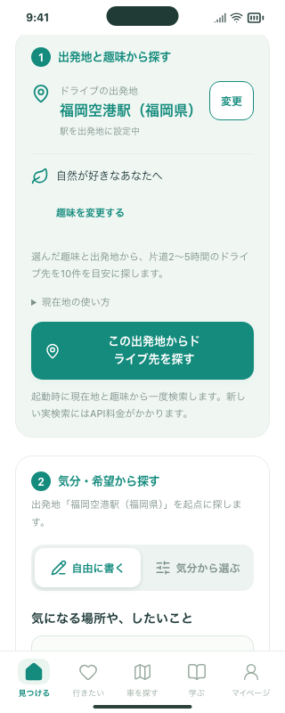

# 出発地を共通にした2つの探し方

2026-10-27 / Issue #126 / PR #125。

利用者の参考画像に合わせ、既存のミント色・角丸・下部5タブを保ちながら、ホームの検索操作を2つのカードに整理しました。おすすめ／イベントの切り替えと候補パネルは引き続きホームの先頭です。

## できること

- **① 出発地と趣味から探す**：出発地の右の「変更」から現在地または駅を設定できます。趣味もこのカード内で変更できます。「この出発地からドライブ先を探す」は、選んだ出発地と趣味で検索します。
- **② 気分・希望から探す**：①と同じ出発地を明記し、「自由に書く／気分から選ぶ」で入力欄を切り替えます。文章と気分の選択内容は保持し、それぞれの検索には他方の条件や初期設定の趣味を混ぜません。
- 設定と検索は別の操作です。出発地・趣味・入力方法を変更するだけでは検索しません。イベントは従来どおり出発地・趣味・日付で検索します。

保存データの移行・削除はありません。AI・経路APIの接続、送信範囲、回数制限、起動時の自動検索、現在地の10分間の保持は変更しません。新しい検索には従来どおりAPI料金がかかります。

## 確認手順

確認用URL：`http://127.0.0.1:5211/#/`（このMac）。一度再読み込みし、候補パネルの下へスクロールします。保存データを消す必要はありません。

1. ①の「変更」で駅を設定し、①②に同じ出発地が表示されることを確認します。①のボタンから趣味のおすすめを探せます。
2. ②の「自由に書く」に文章を入力し、「気分から選ぶ」と往復します。入力内容を保持したまま、希望する方法のボタンで検索できます。
3. 「変更」から現在地に戻すことや、イベントで趣味・日付の検索ができることを確認します。

## 検証

- 無料サンプルの検索連携36件成功。現在地・駅が①②で共通、趣味／自由入力／条件／イベントの送信内容が独立、設定変更だけで検索しないこと、候補の保存・詳細・往復を確認しました。
- ビルド済みアプリの108件成功。駅の選択・キャンセル、現在地の取得・失敗・期限、設定の保持、キーボード操作、下部タブを確認しました。
- Firebase認証エミュレーターを使った公開検索経路の3件成功。自由記述と気分の条件がそれぞれ独立して送られることを確認しました。
- PC・スマホ幅のChromium・WebKit、320px幅・文字拡大で表示を確認。2つの入力欄を切り替えても下書きを保持し、横にはみ出さないことを確認しました。
- 整形、型チェック、アプリ・入力確認ツールのビルド、配信物検査成功。
- 実APIキーのない別の作業場所で検証しました。実AI検索・Google APIは呼んでいません。実機iPhoneでの確認と公開Web・インストール済みiPhone・mainへの反映は未実施です。

以下は福岡空港駅と趣味「自然」を設定した静的プレビューです。実ユーザーの現在地や実APIの候補は含みません。

