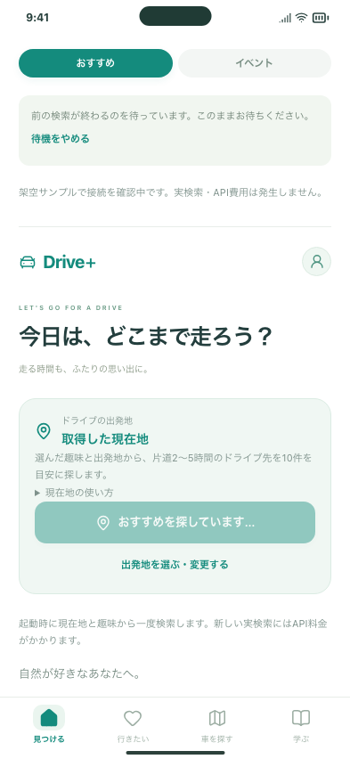

# 起動時に検索中エラーで止まる問題の修正

2026-10-21 / Issue #126 / PR #125。

## 問題と原因

起動時の自動検索が、前の検索処理と重なると「別の検索を実行中です。完了してから操作してください。」で終了していました。サーバーの処理がその後に完了しても、画面は状態を確認し直さず、候補パネルが出ないままでした。画面の再読み込み・中断とサーバーでの検索の終了は同期していません。

## 変更後

- 検索中なら「前の検索が終わるのを待っています。このままお待ちください。」を表示し、2秒ごとに利用状態だけを確認します。空き次第、今回の画面の出発地・趣味などで1回検索します。
- 状態を確認した直後に別の画面が検索を始め、POSTが既知の検索中エラー（HTTP 409）で拒否された場合も、待機に戻します。別種の409、通信失敗、タイムアウトなどは自動再送しません。
- 待機は最大約2分で終了し、時間をおいて再操作する案内を表示します。開始した検索は従来の130秒の制限です。
- 「待機をやめる」、現在地の利用終了、ログアウト・アカウント変更では待機を中止し、後から勝手に検索を送信しません。
- 保存データ、検索条件、候補の並び、他画面の表示文言は変更しません。削除判断待ちの文言はそのままです。

待機中の状態確認はAI・Routes APIを呼びません。空き次第開始する今回の新しい検索には従来どおりAPI料金が発生します。別画面の結果は検索条件が異なる可能性があるため自動流用しません。すでに送信済みの前の検索を中断・返金する機能ではありません。

## 確認方法

このMac：`http://127.0.0.1:5211/#/`。一度再読み込みし、位置情報が求められたら許可して、候補が出るまで待ちます。前の検索が残っている場合は待機表示の後に検索が始まります。

無料サンプル：`http://127.0.0.1:5210/#/`。以下の画像は新宿駅付近のテスト座標、架空の候補と時間で、実APIは使っていません。

|待機|検索完了|
|---|---|
|||

## 検証

- 検索連携75件成功（PC Chromium・スマホ Chromium・スマホ WebKit）。検索中にPOSTしないこと、解除後の1回送信、POST直前の競合、失敗時の再送なし、待機期限、中止・位置情報終了を検証。
- ログイン・アカウント変更・検索・保存12件成功。待機後の検索、待機中のログアウトで別アカウントへ切り替えても送信しないことも確認。
- 待機表示を整えた後、関連15件も再確認して成功。
- 待機とパネル表示のスマホ画像を目視確認。無料サンプルでは待機中POST 0回、空き後1回、10パネル。
- 型チェック・ビルド、整形、入力確認ツールのビルド、静的配信物検査を確認。

自動テスト・画像確認は無料サンプルのみです。ただし、作業中に実API接続画面側の検索記録は12回から14回へ増加しました（18:35、18:36に開始、両社とも完了）。開いている開発画面の自動再読み込みや利用者の操作は区別できないため、作業全体を「追加呼び出しなし」とは扱いません。起動時検索がある実API画面では、再読み込みにも料金が発生します。公開Web・既存iPhoneへの反映、PRのマージは今回行いません。
