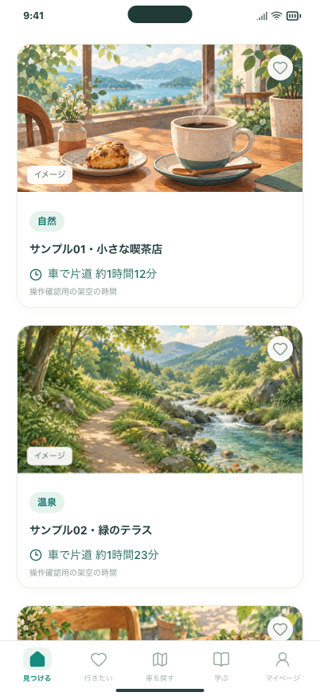

# イベント検索の終了

2026-11-03。ホームのイベント検索を終了し、先頭からおすすめパネルを表示します。

## 変更と影響

- 「おすすめ／イベント」の切り替え、イベントの日付選択、イベント専用検索のプロンプトを撤去。
- 出発地＋趣味、自由入力、気分・条件の検索を継続。初期設定と検索参加画面の説明も更新。
- 旧「イベント」「今週末」を保存していた端末はおすすめへ移行。古い日付選択を破棄し、希望・出発地・趣味・行きたい・学習記録は維持。
- 保存済みイベントの詳細・開催情報・出典は引き続き表示。過去の保存データの読み取りに必要な型・検査・サンプルを互換用に維持。趣味の「季節イベント」は通常の行き先検索の希望として残す。
- 古い画面からのイベント専用リクエストは、ローカル／公開検索共通の入口でAPI呼び出しと利用回数加算の前に拒否。

## 確認する操作

1. Macの http://127.0.0.1:5211/#/discover を再読み込み。イベントタブがなく、検索完了後はカードが先頭から並ぶ。
2. 下の欄から「この希望で探す」または「気分から選ぶ」で検索。同じ出発地で、趣味検索とは独立した条件を使う。
3. 「行きたい」から保存済み候補を開く。以前保存したイベントも開催情報とともに閲覧できる。

## 費用・反映範囲

検証には無料サンプルと差し替えたAPI応答を使い、有料APIの呼び出しは0回。通常のドライブ検索の送信先・費用は従来どおり。Macの開発URLへ反映し、公開Web・配信済みiPhone版のデプロイは含まない。

## 検証

- 型チェック、整形、アプリ／掲載情報ツールのビルド、配信物検査：成功。
- 検索ロジック70件・公開検索入口13件・検索画面156件・掲載情報ツール54件：成功。
- 5211番の実画面に無料サンプルを接続し、カード10枚、タブ0個、保存警告なし、横はみ出しなしを確認。
- 稼働中の検索サーバーを更新し、旧イベントリクエストがHTTP 400で拒否され、利用回数が増えないことを確認。
- 全画面の静的プレビュー検証は実行中。

