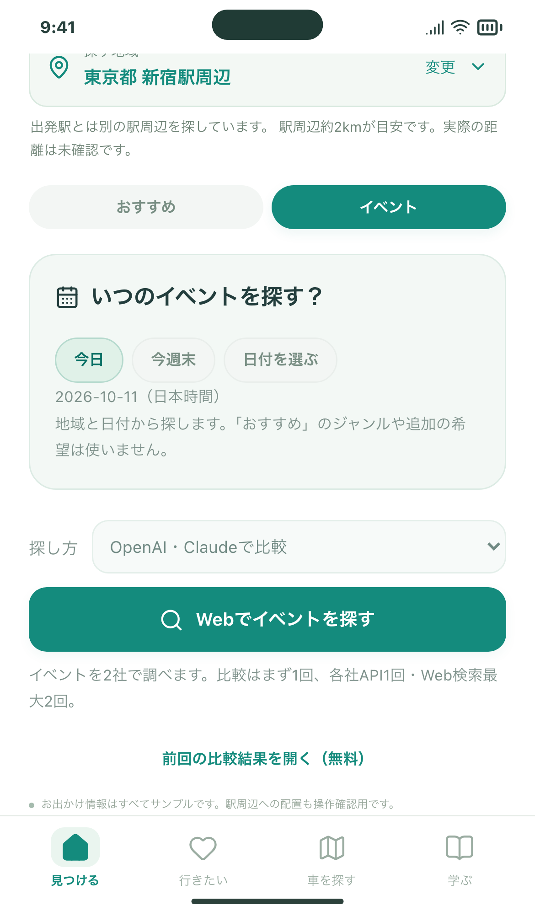
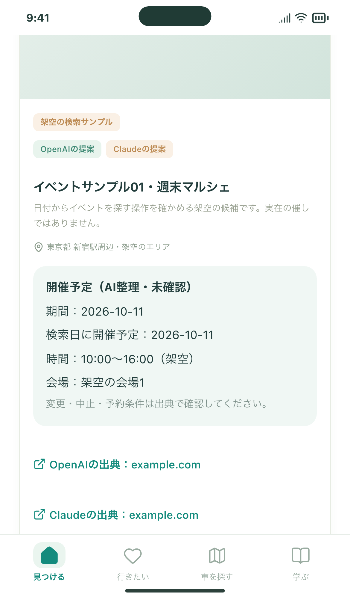
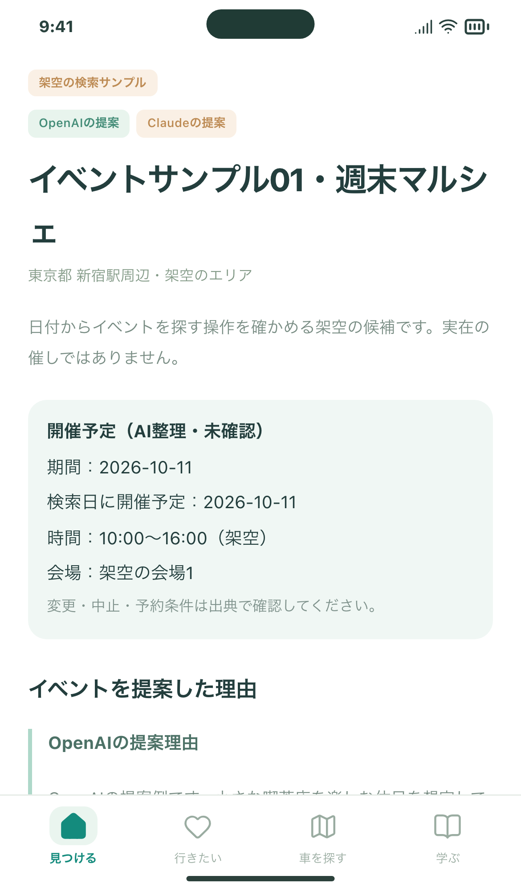

# Issue #112：イベントを地域と日付で探す

実装内容と試す3操作は [EVENT_SEARCH.md](../../EVENT_SEARCH.md) にまとめています。PR #111を土台にした追加変更です。

確認画面は架空の検索候補です。有料のAI検索や実在イベントの正確さを確認した画像ではありません。

- `tools/spot-research/tests/events.test.mjs`：日本時間・週末・閏日、範囲外・中止・出典欠落の除外、開催回別の重複。
- `tools/discovery-search/tests/events.spec.ts`：条件の分離、タブ間の結果保持、日付変更で再検索しない、保存・詳細・無料復元、遅延応答。
- `tests/web-events.spec.ts`：保存形式、旧設定の移行、過去イベントの表示。
- `tools/public-search/worker.test.mjs`：イベント＋おすすめで共通5回、入力エラーは消費せず、GPS検索結果に座標を保存しない。
- `tools/public-search/browser/flows.spec.ts`：公開版の認証経由で両検索を交互に使い、5回で停止・無料復元。
- iOSの `testEventSearchControls`：実際のWKWebViewでタブ・日付・条件保持・ログイン前の検索制御。専用シミュレーターを使用し、ユーザーのデータは変更しません。

実施結果、CI、公開反映・シミュレーター更新の情報はIssueのコメントに追記します。実機の指操作、実APIの候補精度・請求額は未確認です。

## 無料サンプルでの画面

