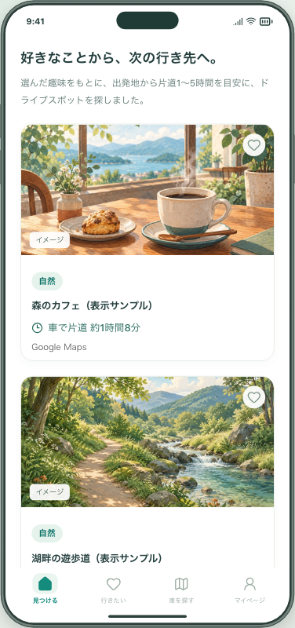
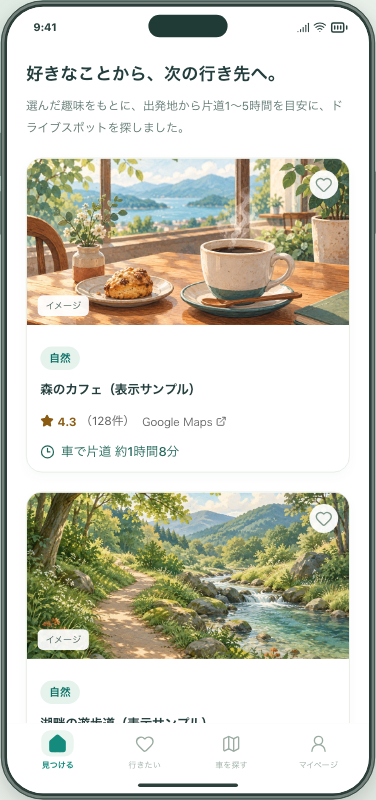

# Google評価表示の確認

## 背景・変更

検索したスポットを比べる材料として、名前・趣味・所要時間に加えてGoogleの星評価と口コミ件数を表示する。利用者は評価の行から、その施設のGoogle Mapsを開いて確認できる。

## 画面

以下は実装したアプリをPlaywrightで撮影した画像。施設名・評価4.3・口コミ128件・所要時間は**架空の検証データ**であり、Googleの実データを保存した画像ではない。主な比較点は、最初のパネルの名前と所要時間の間にある評価行。2枚目は評価を取得できなかった場合もパネルが残る例。

| 評価なし（従来と同じ表示） | 評価あり                             |
| -------------------------- | ------------------------------------ |
|     |  |

画像はmainから分岐した本PRの画面。別PR #145のホーム見出し改善は含めない。Macの5211番では、その見出し改善も保った確認用ブランチを使う。

## 検証内容

- サーバー：名称・都道府県・市区町村の照合、同名別店舗・複数一致・未評価の除外、最大10回・同時5回、キーなし・403・429・不正応答・タイムアウトでもカード維持。
- パイプライン：Brave → Gemini → Routes → 表示対象10件の評価取得という順序と、趣味の配分を維持することを通信モックで確認。
- 保存：評価を端末の保存データ・共有候補・保存結果から除外し、使用量記録には件数だけを記録することを確認。
- ブラウザ：PC、スマートフォン幅のChromium、スマートフォン幅のWebKitで、カード・詳細・外部リンク・保存・再読み込み・10分後の非表示を確認。実機iPhoneの検証ではない。
- 実API：2026-11-11、既存のPlacesキーで「松本城／長野県松本市」を1回照合。HTTP 200で評価取得成功、約0.4秒。個人の現在地は使用せず、返却された評価値・生応答はファイルに保存していない。

- 実検索：同日、新宿駅・趣味「自然」でBrave 3回、Gemini 1回、Routes 1回、Places 10回を実行。約13.8秒で10候補・全10件の所要時間を取得し、4候補に評価が表示できることを確認。6候補は照合または評価の条件を満たさず非表示。候補は10件のまま。実データの画像は保存していない。

実APIの評価取得は上の単体確認を含めて11回。使用量記録は `.local-research/google-ratings-validation/comparison-v1/usage.json` に件数だけを保存。単体確認の1回はこの文書に記録する。

設定・送信情報・料金と対象外は[機能ガイド](../../GOOGLE_PLACE_RATINGS.md)を参照。
