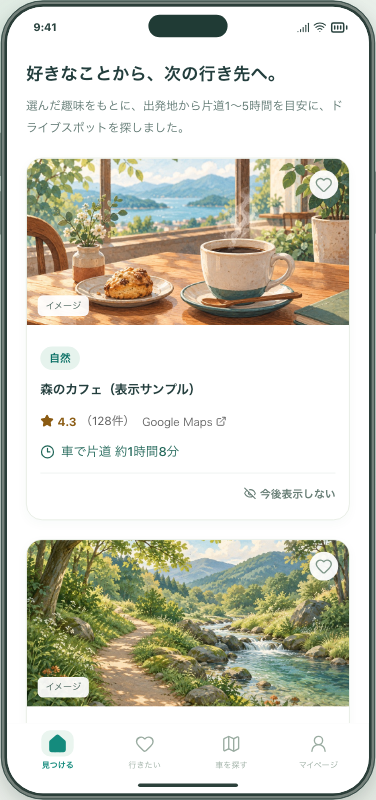
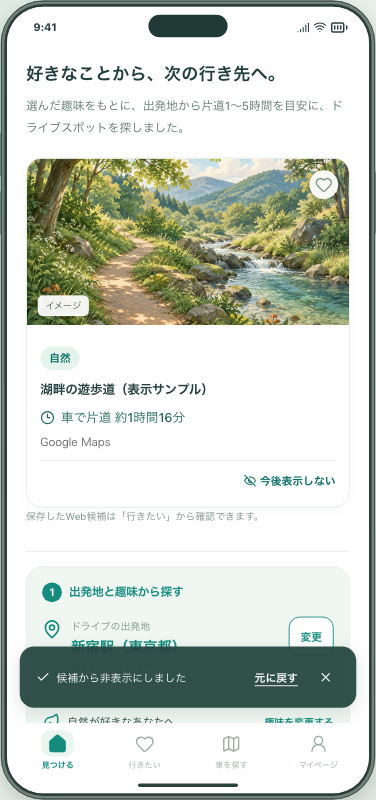
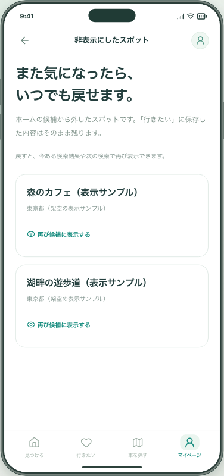
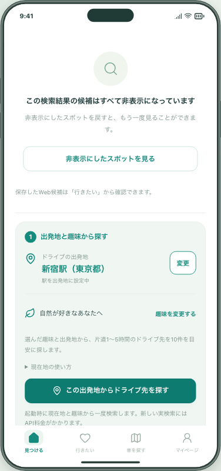

# 興味のないスポットを候補から外し、あとで戻す

関連Issue: [#150](https://github.com/Greek-Academy/Let-s-go-anywhere/issues/150)

## 背景と変更

ホームで気にならないスポットを見つけても、次の検索でまた表示されることがありました。パネル下部の「今後表示しない」で候補から外し、直後の「元に戻す」、または「マイページ → 非表示にしたスポット」から復活できます。

- ホームだけに適用し、「行きたい」や共有リストの内容は変更しません。
- 趣味・自由入力・気分の検索、過去の検索結果、再読み込み後の検索でも除外します。
- 復活した場所が保持中の結果にあれば、その場で再表示します。なければ次の検索で候補になれます。非表示・復活だけでは検索しません。
- 全件を非表示にした場合は、検索失敗とは別の案内と一覧へのボタンを表示します。
- 非表示一覧は同じブラウザ／アプリ内に保存します。端末間で同期しません。「モックの保存データを削除」で消えます。

## 画面

いずれも実装をブラウザで動かした画像です。スポット名・評価・所要時間は架空の検証データで、有料APIを呼んでいません。

| パネルから非表示 | 取り消し | 一覧から復活 |
| --- | --- | --- |
|  |  |  |

## 保存・照合の考え方

新しい `hiddenWebSpots` には名前、地域、実検索かサンプルかの区別、該当するときだけ既存の確認済み地点IDを保存します。検索ID・出典URLの変化に依存せず、全角半角・空白などを正規化した名前と地域、または既存の確認済み地点対応で照合します。名称だけでは一致とみなしません。

別地域・別支店名は除外しません。ただし、AIが同じ場所を未確認の別名・別住所で回答すると一致を判断できない場合があります。逆に、入力情報自体が同じ名前・同じ地域だけで別支店を区別できない場合、完全な識別はできません。新たな地点確認APIは追加していません。

Googleの評価・件数・URL・経路情報・現在地はこの一覧に保存せず、非表示履歴も検索サービスへ送信しません。旧データは空の一覧として移行し、元の保存内容を維持します。旧サンプル用の `hiddenEvents` は別に維持し、設定のリセット文言をサンプル対象と明示しています。

保存完了を待って通知し、失敗時は既存の保存状態の案内と明示的な再試行につなげます。取り消し通知は自動で消さず、操作・閉じる・別の通知で終了します。保存領域保護中は新しい非表示操作を無効にします。保存データ全体の既存制限に合わせて一覧は最大1,000件で、超過時に既存項目を黙って削除しません。

## 確認

- `tests/hidden-spots.spec.ts`: 同一地点の再検索、別支店・地域、確認済み住所の表記違い、旧保存の移行、保存項目の最小化、不正データの保護。
- `tools/discovery-search/tests/hidden-spots.spec.ts`: 非表示、取り消し、全件非表示、一覧復元、保存済み候補の保持、再起動、3種類の検索、過去結果、追加APIなし、履歴を外部送信しないこと、保存失敗・再試行・全削除。
- PC幅とスマートフォン幅のChromium、スマートフォン幅のWebKitで操作。実機iPhoneの確認・配布は別途です。
- 既存の保存・ネイティブ保存ブリッジ・同一地点判定のテストでも影響を確認します。CIの結果はPRに記載します。

## 試す操作

1. ホームで1枚の「今後表示しない」を押し、直後の「元に戻す」で取り消します。
2. 再度非表示にして検索し直し、そのスポットが候補から外れたままか確認します。
3. マイページの「非表示にしたスポット」から「再び候補に表示する」を押し、ホームで戻ることを確認します。

Macの5211番のプレビューへ反映する変更です。公開Web・iPhoneには配布しません。Issueは利用者の確認とマージまで開いたままにします。
