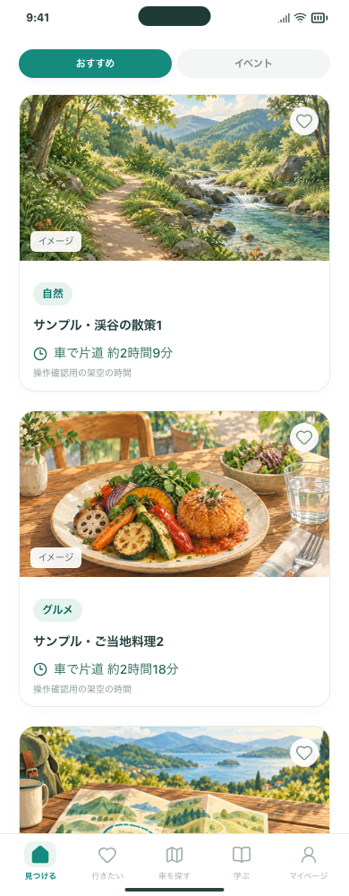
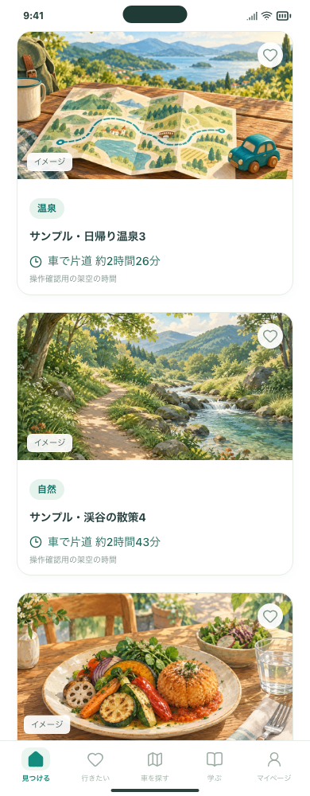
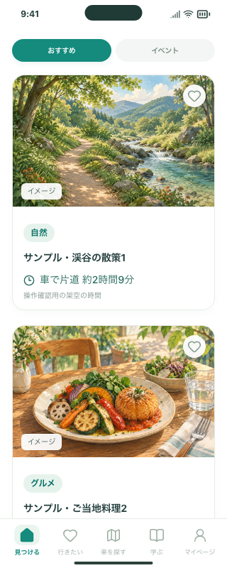

# 趣味ごとのおすすめと小さなラベル

2026-10-28 / Issue #127。PR #125 のホーム構成を土台にした追加変更です。

## 変わること

- 自然・グルメ・温泉なら最大10枚を4・3・3枚を目安に配分します。AIにも趣味別の件数を渡し、出典・日付・重複・所要時間を確認した後に、アプリ側の選定処理で調整します。
- 趣味の順に候補を交互に並べます。複数趣味に対応する場所も1枚・1枠として数え、候補が少ない趣味の枠を確保できるよう割り当て直します。足りない枠は他の選択済み趣味で補い、候補自体が少なければ10枚未満にします。
- 写真の下、場所名の上に「自然」「グルメ」などのラベルを控えめに表示します。詳細画面でも確認できます。これは候補を割り当てた趣味であり、AIが出典から整理した分類です。
- 趣味から探すイベントにも同じ配分を適用します。自由入力・気分検索や趣味未選択の検索には趣味を追加しません。

AIの返答には選択済みの趣味のみを許可し、対応情報が欠ける・重複する・未選択の趣味を含む候補は除外します。出典内容そのものの事実確認を自動保証する機能ではありません。趣味に合う候補を必ず各件数見つけられるわけではなく、自動の追加検索も行いません。

## 保存・費用

候補に趣味の対応と表示ラベルを保存します。古いデータを消す・移行する操作は不要で、古い候補には推測のラベルを後付けしません。現在の趣味設定を変えても、前の結果のラベルは変わりません。共有候補には趣味データを追加せず、位置・所要時間の保存方針も変更しません。

OpenAI・Anthropic各1リクエスト、Web検索各最大2回、Google経路計算最大1リクエストのままです。趣味の数だけAPI呼び出しを増やす処理はありません。入力指示と回答項目が増える分、トークン料金は変わります。今回の確認は無料の架空応答で行い、実AI・Googleは呼んでいません。

## 試す操作

このMacの確認用URL：`http://127.0.0.1:5211/#/`。

1. 「趣味を変更する」で自然・グルメ・温泉を選びます。
2. 「この出発地からドライブ先を探す」を押します。新しい検索から趣味別の配分・ラベルが反映されます。起動時の自動検索にも適用します。
3. ラベルと場所名・時間を確認し、候補をタップすると説明・出典・趣味を確認できます。保存後も詳細で趣味ラベルを確認できます。

実データでは候補不足・時間条件・両社の失敗などで件数が減る場合があります。保存データの削除は不要です。公開Web・インストール済みiPhone・mainの更新は今回行いません。

## 検証

- 検索処理49件成功：3趣味の4・3・3配分、候補不足、10趣味、多趣味候補の割り当て直し、重複統合、時間除外後の選定、不正分類の除外、片方AIの失敗、追加呼び出しなし。
- 公開サーバーの無料テスト13件成功、Workerビルド成功。
- 検索連携54件成功：PC・スマホChromium・WebKitで初期設定からの趣味送信、交互のラベル、設定変更と再検索、独立した自由入力・気分・イベント、保存して再読み込みした詳細を確認。
- ビルド済みアプリ93件成功。保存・旧データとの共存、不正ラベルの拒否、共有への非送信、ナビゲーションを確認。最終の重複統合調整後に関連21件を再確認。
- 390pxスマホ・320px・文字拡大・PC・WebKitでラベルと横のはみ出しを確認。整形・型チェック・ビルド・入力確認ツールビルド・配信物検査を実施。
- 実際のAIによる候補の充実度と実機iPhoneは未確認です。図は架空候補と固定のテスト位置を用いた画面確認で、施設名・画像の分類を趣味に合わせた表示用fixtureにしています。

