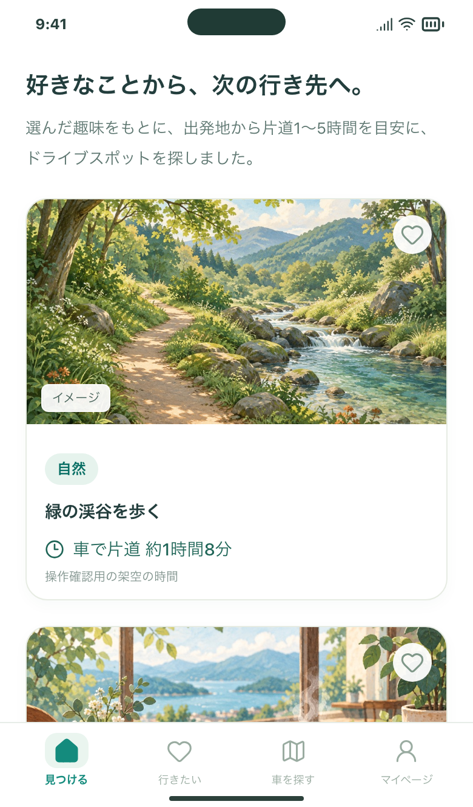
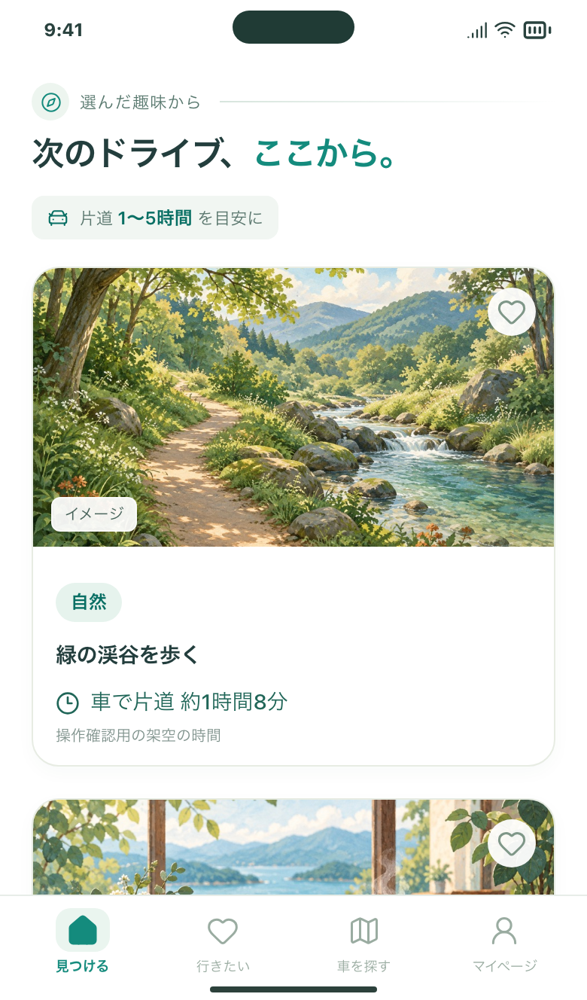

# ホームの導入を、短い見出しと片道時間の案内に整える

## 背景・課題

候補一覧の上に長い説明文があり、写真を見る前に説明を読む印象になっていました。既存の緑と白のデザインに合わせ、検索のきっかけ・見出し・時間の順に、短く見渡せる導入へ変更しました。

## 変更後

- 見出しは「次のドライブ、ここから。」。「ここから。」をアクセントカラーにしました。
- 上段にコンパスの小さなアイコンと「選んだ趣味から」。自由入力は「あなたの希望から」、条件検索は「選んだ気分・条件から」、趣味未選択は「出発地から」と表示します。
- 下段に車のアイコンと「片道 1〜5時間 を目安に」を淡い緑の帯で表示。時間は表示中の検索結果に合わせます。
- 出発地や趣味、時間を編集しただけでは、表示済みの結果の説明を変えません。候補0件・未検索・旧イベントの結果には導入を表示しません。

見出しは読みやすいまとまりで折り返し、文字を大きくする設定にも対応します。390px幅で最初のパネルは画面上端から約177pxにあり、初期表示で写真と場所名・時間まで確認できます。

## 画面

実際のReact画面を、架空の候補・所要時間で撮影しています。利用者の保存データや実際の現在地は使用していません。

| 変更前 | 変更後 |
| --- | --- |
|  |  |

[PCでの表示](after-desktop.png)／[320px幅・文字拡大・WebKit](after-webkit-narrow.png)

## 確認

5211番の開発画面を独立したブラウザで開き、API通信をすべて架空の応答に置き換えて確認しました。ChromiumとWebKitで、趣味あり・趣味なし・自由入力・気分と時間指定・候補0件、未送信の編集が表示中の案内を変えないことを確認。320px幅の文字拡大で横にはみ出しません。[表示の測定記録](after-verification.json)。

自動チェックの結果は、このPRの確認結果に追記します。ブラウザのWebKitでの確認は、iPhone実機での確認ではありません。

## 試す操作

1. Macで `http://127.0.0.1:5211/` を開き、趣味検索後のホーム上部を確認します。
2. ホーム下部で自由入力、または気分・時間を選んで検索すると、上段の案内と片道時間がその結果に合うことを確認できます。

検索処理・保存データ・外部送信先・パネルの操作は変更していません。今回の確認で実APIの実行・追加課金はありません。通常の実検索には従来どおりAPI料金が発生します。公開Web・iPhoneへの反映は行っていません。

関連Issue：#141。#144をマージ済みのmainを土台にした、ホームの見た目だけの変更です。
