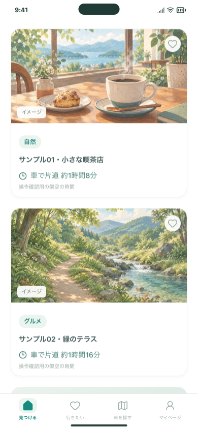
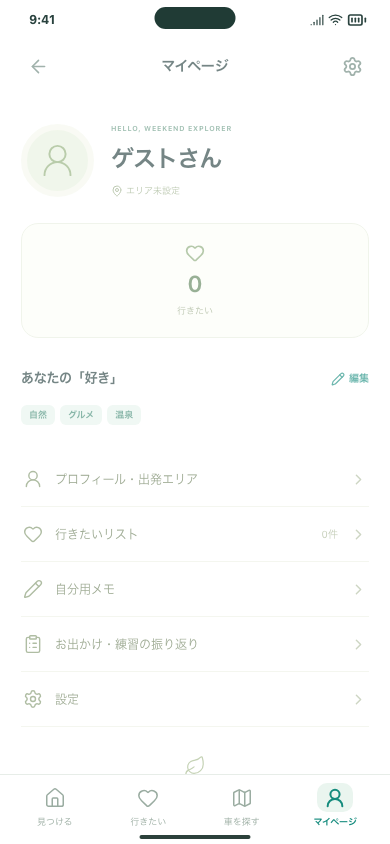

# 「学ぶ」タブの終了 — Issue #137

「見つける・行きたい・車を探す・マイページ」の4タブに整理しました。教材・コラム・学習履歴の画面と、それらへ進むボタンを取り除いています。利用者が入力したメモは削除せず、マイページの「自分用メモ」に引き継ぎました。

## 試す操作

1. ホームを再読み込みし、下部に4タブが並び、検索候補を開いたり保存できることを確認します。
2. マイページ → 自分用メモを開きます。以前のメモが残り、編集して再読み込みしても保持されます。
3. 以前の `#/learn` を開くとホームへ、`#/learn/notes` は自分用メモへ移動します。「戻る」で廃止画面を行き来することはありません。

## 影響範囲

| 対象                                          | 変更後                                                     |
| --------------------------------------------- | ---------------------------------------------------------- |
| 下部ナビゲーション                            | 4タブ。マイページも常時表示                                |
| 教材・コラム・学習履歴                        | 画面・教材データ・カード・専用CSSを削除                    |
| マイページ・設定・振り返り                    | 学習リンクを撤去。個人メモは「自分用メモ」に統一           |
| 知識・不安チェック                            | チェックと回答解説は保持。学習への誘導をドライブ検索へ変更 |
| 共有・外部リンク・保存状態の説明              | 現在の機能名に統一。外部送信しない旨は保持                 |
| `/learn/*`、旧講習・相談URL                   | ホームへ置き換え遷移                                       |
| `/profile/learning`、`/profile/consultations` | マイページへ置き換え遷移                                   |
| `/learn/notes`                                | `/profile/notes` へ置き換え遷移                            |
| 掲載情報の確認ツール・画面撮影スクリプト      | 新しい4タブとメモ導線に更新                                |

保存形式は変更していません。`memo.questions` の内容、旧学習ID・記録日、チェックの回答、保存候補、振り返りを保持します。旧学習履歴は画面から非表示になりますが、端末内データには残ります。明示的な「保存データを削除」操作だけがこれらを削除します。

## 確認結果

- 型チェック・アプリビルド・掲載情報確認ツールのビルドが成功。
- ChromiumのPC／スマートフォン幅、およびスマートフォン幅のWebKitで、4タブ・戻る操作・旧URL・保存データ保護・メモ編集・チェック解説を確認。関連81ケースが成功。
- 実際の開発URL（5211）でも架空の検索応答を使い、10件の候補・4タブ・メモと旧履歴の保持・横はみ出しがないことを確認。
- 全体回帰テストとGitHub CIの最終結果はPRから参照できます。
- 入力候補確認テストでは、iframeの起動前に「カード0件」が成立してしまう待機条件を修正。画面が起動した後に詳細を開きます。

検証は架空データ・無料の応答で行い、AI・写真・経路APIへの実送信や追加課金はありません。検索API・共有権限・保存方式を変更していません。公開環境への配信、iPhoneへのインストールと実機確認は行っていません。iOS操作テストのソースだけを新しい導線に合わせています。

## 画面

検索カードはテスト用の架空データです。

## 関連

- [Issue #137](https://github.com/Greek-Academy/Let-s-go-anywhere/issues/137)
- [前提のPR #136](https://github.com/Greek-Academy/Let-s-go-anywhere/pull/136)：イベント検索終了後のブランチを土台にしています。
- iPhone確認は利用者の指示により後回しです。
