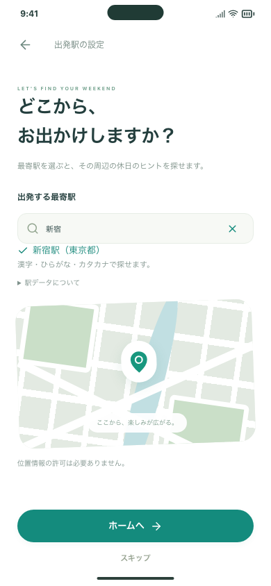
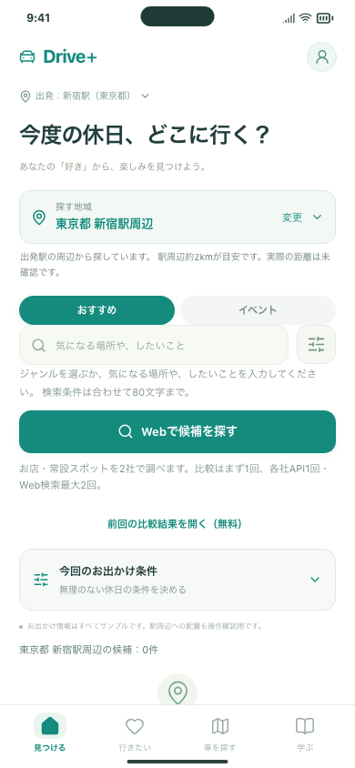

# 初期設定の短縮・ラーメン診断の取り下げ（Issue #124）

「運転したい」を起点にする方向へ合わせ、最初の設定を出発駅だけにしました。
**ウェルカム → 出発駅を選ぶ → ホーム**の順で進みます。
同行者・興味を尋ねる2画面は表示しません。出発駅の設定はスキップできます。

ラーメン診断はmainへ追加する前だったため、PR #123を取り下げました。
関連Issue #122は「対応不要」で閉じ、履歴と別プロジェクトの元ファイルは残しています。
この版のホームに診断ボタンはなく、診断写真・問題・採点コードも配信物に含みません。

## 確認する3操作

同じMacで起動中の確認版： http://127.0.0.1:5188/#/welcome

1. 「はじめる」→最寄駅を入力→候補を選ぶ→「ホームへ」。同行者・興味を聞かれず、ホームに進むことを確認します。
2. 上のURLを開き直す→「はじめる」→左上の「戻る」→もう一度「はじめる」→「スキップ」。戻る・スキップが動き、以前の駅や保存内容が残ることを確認します。
3. ホームと「行きたい」「車を探す」「学ぶ」を開きます。診断の入口がなく、保存した候補や既存の機能を使えることを確認します。

このURLはこのMac専用です。公開版や、すでにインストールしたiPhoneアプリはまだ更新していません。iPhoneはマージ後のコードで再ビルドすると反映されます。

## 画面

| 出発駅だけの初期設定 | 設定後のホーム |
| --- | --- |
|  |  |

[PC上のスマートフォン枠](station-desktop.png)。スマートフォン幅は390×844で確認しました。

## 保存データへの影響

- 行きたい、車候補、学習履歴、出発駅などを維持します。プロフィールにすでに保存されている同行者・興味と、その編集機能も維持します。
- 以前の診断確認版を使った端末では、既知の形式の診断回答だけを読み飛ばし、次の通常保存から除きます。他の保存内容を初期化しません。
- 不正な形式や未知の保存項目を受け入れるようには変更していません。破損したデータは従来どおり自動上書きから保護します。
- 旧設定2・3のURLは、未設定なら出発駅、設定済みならホームへ戻します。旧診断URLはホームへ戻します。
- 追加のAPI呼び出し・外部送信・費用はありません。

## 開発側の確認

- 型チェック・ビルド、整形、配信物の検査に成功しました。
- 初期設定、駅選択、全4タブ、保存、学習、地図、戻る操作、フォーカス移動、端末保存のテストが108件成功しました（PC Chromium・スマホ幅Chromium・スマホ幅WebKit）。
- 旧診断データがある状態での読み込み、出発駅の変更・再保存・再読み込みを確認しました。診断以外の保存内容は維持されます。
- PC・スマートフォン幅の画面画像を目視確認しました。WebKitはブラウザ相当の検証で、今回の変更をiPhone実機へ入れた確認はまだです。
- GitHubの全体CI結果はPRとIssue #124に記録します。

## 今回の範囲

ホーム全体の再設計や推薦の計算方法の変更は、この3点の整理には含めません。検索ジャンルの絞り込みは引き続き使えます。
