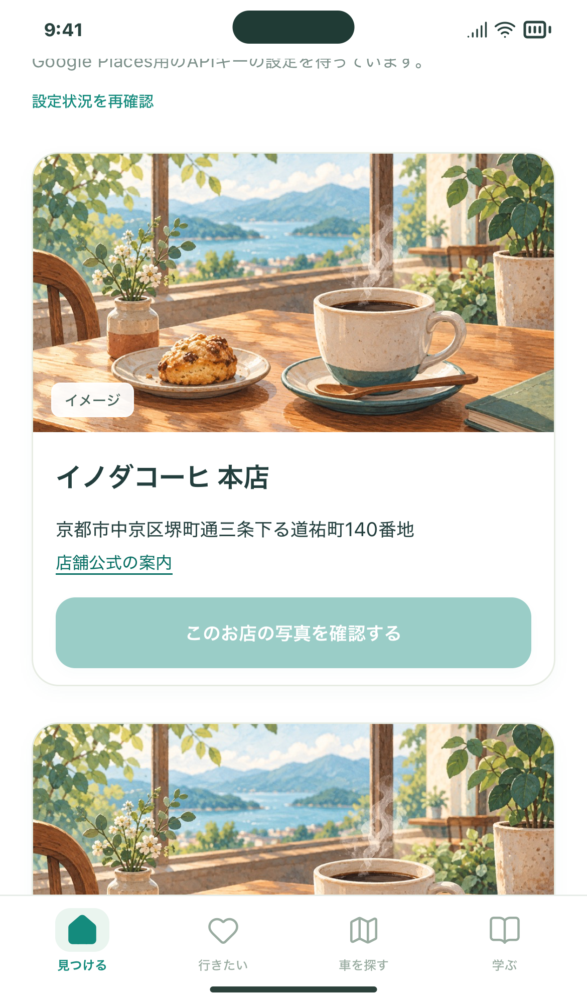

# 3店舗限定・実写真の取得検証（#118）

対象は京都のイノダコーヒ本店、スマート珈琲店（寺町）、小川珈琲堺町錦店です。店舗公式の住所を使い、Google側の店名・市区町名・番地が一意に一致したときだけ1枚取得します。対象外と取得失敗はイラストです。

## 試す操作

1. [キーの作成・保存手順](../../PLACE_PHOTOS_PILOT.md)に沿って準備する。
2. Macで http://127.0.0.1:5186/#/photo-pilot を開き、「設定状況を再確認」。
3. 各店舗の「このお店の写真を確認する」を押し、写真と店舗の一致・出典を確認する。

この画像は写真の取得前です。実写真が取れたという証拠ではありません。実Google APIでの取得・料金確認はキー設定後に行います。

## 開発側の検証

- サーバー6ケース：対象外・キーなしではGoogleへ送信しない。同時操作・再起動で上限をリセットしない。名前一致だけ・番地の部分一致・複数候補は写真取得へ進まない。API例外・不正URL・過大応答でも秘密を返さず自動再試行しない。
- PC Chromium／スマホWebKitの6フロー：取得ボタン・撮影者・元写真リンク・画像失敗時のイラスト・再読込時の取得停止を確認。レスポンスを架空データに差し替え、外部APIは呼んでいません。
- 開発サーバーでも.envを配信せず、外部Origin・トークンなし・対象外IDを拒否することを確認。
- 写真データはカード表示の間だけ。ブラウザ保存・共有・キーの配信なし。

公開URLとiPhoneアプリは今のイラスト表示を維持します。今回のルート・取得APIは専用の開発モードだけで有効です。一般公開版へ写真を接続するのは、実写真・費用の確認後です。
