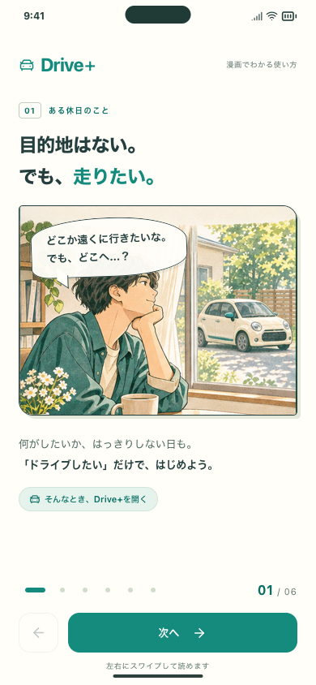
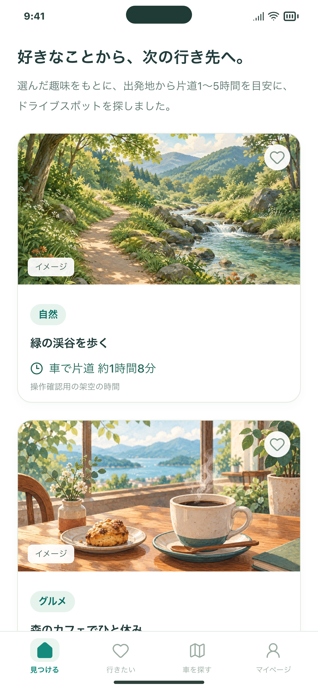

# PRを整理し、確認する場所を2つにまとめる

2026年11月6日。開いていた16件のうち14件を閉じ、確認先を2件に整理しました。現在のアプリのコードと開発履歴を保持し、マージ・公開配信は行っていません。

## 残すもの

| 確認先                                                                 | 残す理由                                                           | 状態                                                                                         |
| ---------------------------------------------------------------------- | ------------------------------------------------------------------ | -------------------------------------------------------------------------------------------- |
| [PR #144](https://github.com/Greek-Academy/Let-s-go-anywhere/pull/144) | 今の「ドライブしたいけど目的地がない人」のための体験をまとめて残す | これまでの10件の変更を含む。比較先をmainへ変更し、本文と画像を整理。未マージ。               |
| [PR #121](https://github.com/Greek-Academy/Let-s-go-anywhere/pull/121) | Viteなどの既知の脆弱性を減らす依存ライブラリ更新を残す             | 更新後にも残る指摘があり、CIも未通過。アプリの統合後に最新コードとの組み合わせで再検証する。 |

ライブラリ更新を一括して不要と判断しませんでした。GitHubのDependabotアラート一覧は空でしたが、ロックファイルを対象にした `npm audit` で既知の脆弱性の指摘が見つかったためです。指摘は依存関係の報告であり、このアプリへの攻撃が成立することを確認したものではありません。今回、自動修正や強制的なバージョン変更は行っていません。

同日の検査では、現在のコードで30件（high 13／moderate 17）、#121のロックファイルでは24件（high 6／moderate 18）でした。#121ではViteなど6パッケージが指摘から外れますが、すべての問題が解消するわけではありません。更新案のファイルを別の一時フォルダで検査し、稼働中アプリの依存関係は変更していません。

## 引き継ぐアプリの変更

| 閉じるPR | 変更の内容                                                                               | 引き継ぎ先                                  |
| -------- | ---------------------------------------------------------------------------------------- | ------------------------------------------- |
| #125     | 現在地・趣味からのホーム検索、検索の重複・リセット・タブ復帰の修正、出発地と検索欄の整理 | #144                                        |
| #128     | 複数の趣味を反映した配分と、パネルの趣味ラベル                                           | #144                                        |
| #130     | Geminiを使う検索                                                                         | #144（現在はBraveを組み合わせる方式も実装） |
| #132     | Brave Search＋Geminiで関連検索バーを出さずに候補を作る方式                               | #144                                        |
| #134     | 写真と車の検索待ち画面、失敗時の説明・再試行                                             | #144                                        |
| #136     | イベント検索の終了、保存済みの情報を保持                                                 | #144                                        |
| #138     | 「学ぶ」の終了、4タブとマイページへのメモ移行                                            | #144                                        |
| #140     | 開始画面の入口を「はじめる」に統一                                                       | #144                                        |
| #142     | 候補一覧の上に検索内容の説明を表示                                                       | #144                                        |

#144自身の漫画ガイドも残します。Gitの履歴で、上記すべてのPRの先端コミットが整理前の#144（`cb6824a4b7851d81f0a8dde3e893daa2df292e91`）に含まれることを確認しました。不要になったイベント・学習画面などが復活する変更は行っていません。

## いったん閉じる自動更新

#56（TypeScriptのメジャー更新）、#67（Node.js型定義のメジャー更新）、#106（setup-node）、#107（upload-artifact）、#120（setup-java）は更新案を保管して閉じました。#67は現在の実行環境Node.js 24との整合も必要です。今後の必要性・互換性を確認して、必要な更新だけ再開します。#121にこれらの差分が取り込まれたという意味ではありません。Dependabotの設定・アラートは無効にしていません。

一部の自動更新PRでは、閉じた後にDependabotがGitHub上の作業ブランチを自動削除したことをイベント履歴で確認しました。元のコミットはローカルの復元用参照とGit bundleに保持しており、更新案を復元できます。アプリの作業ブランチ10件と、残す#121のブランチは維持されています。

## 画面

現在のアプリの入口と候補一覧です。候補名・所要時間は画面確認用の架空の情報です。

| 漫画で使い方を案内                                     | 趣味から見つけた候補を表示                               |
| ------------------------------------------------------ | -------------------------------------------------------- |
|  |  |

`home-sample.png` は2026年11月6日に `cb6824a` の実際の画面を別ブラウザで撮影した画像を使用しています。応答を架空データに差し替え、外部通信と実際の位置取得を行わず撮影しました。元のポスター用画像は変更していません。漫画画像は[漫画ガイドの確認記録](../comic-guide/README.md)から使用しています。

## 保全と確認

- 整理前の16件のPR番号・本文・ブランチ・コミット・確認状態をローカルに保存。
- mainと16件の先端コミットをGit bundleに保存し、`git bundle verify`を通過。復元用のGit参照も保持。
- 現在のmainが#144に含まれること、9件の変更が#144に含まれることを確認。アプリのファイルには整理に伴う変更を加えない。
- アプリの作業ブランチ・作業フォルダ・APIキー・保存データ・ポスター・PRDを維持。関連Issueを実装完了として閉じていない。
- 今回のファイル変更はPRの書き方・確認先の説明・確認画像。書式とリンクを検査する。アプリのビルドや画面テストの再実行は文書変更のため省略し、過去の検証と区別する。

ローカル保管先：`/Users/seyamayoshihiko/Desktop/letsgoanywhere/artifacts/pr-cleanup-2026-11-06/`。Git bundle、整理前のPR情報、祖先関係の検査結果、依存関係の検査結果を保存します。非公開の設定やAPIキーは新たに収集しません。

## アプリの検証状況と残ること

既存の[漫画ガイドの検証記録](../comic-guide/README.md)ではアプリ537ケース、入力ツール54ケース、関連する検索・保存・復帰48ケースを確認しています。これは以前のコード検証であり、今回新しく実行した結果ではありません。

[直前のGitHub CI](https://github.com/Greek-Academy/Let-s-go-anywhere/actions/runs/42052683476)はFirebaseの検査が成功し、もう一方はブラウザ導入の段階でキャンセルされています。ブラウザ検査の成功とは扱いません。最新のCI結果はPRのChecksを参照し、通過とレビュー確認の前にマージしません。

Macのブラウザ版は従来の `http://127.0.0.1:5211/` です。今回、有料検索の実行、公開Webへの配信、iPhoneへのインストールは行いません。

## 今後のPR

背景・課題、実装した解決策、画面画像、確認結果の順に、日本語で説明します。同じ目的の追加修正は同じPRを更新し、目的が別の変更だけ分けます。画像は本文で見られるように貼り、画面変更がなければ理由を記載します。[開発ルール](../../../CONTRIBUTING.md)と[テンプレート](../../../.github/pull_request_template.md)へ反映しました。
