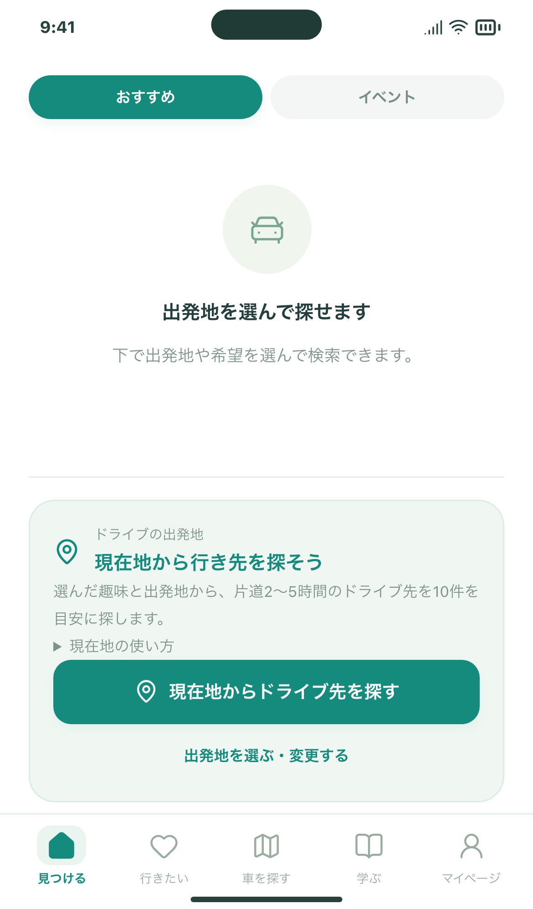
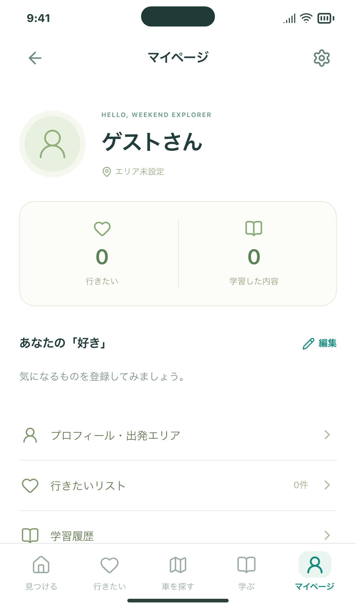

# ホームの見出し欄を削除し、マイページを下部タブへ

2026-10-26 / Issue #126 / PR #125。

ホームの操作欄にあった「Drive+」、プロフィールの丸いボタン、「LET'S GO FOR A DRIVE」「今日は、どこまで走ろう？」「走る時間も、ふたりの思い出に。」を削除しました。候補パネルの下には出発地・検索の操作欄が続きます。読み上げ・画面移動用の非表示の見出しは「見つける」に統一しました。

下部のタブを「見つける／行きたい／車を探す／学ぶ／マイページ」の5つにしました。「マイページ」から既存のプロフィール画面を開けます。プロフィール編集・学習履歴・設定・振り返りもマイページの選択状態を表示します。他の画面の既存プロフィールボタンから開いた場合も、元の画面のタブではなくマイページが選択されます。

保存データの移行・削除はありません。検索条件、現在地の保持時間、API接続や課金設定を変更しません。未判断の説明文や他の画面のヘッダーは削除していません。

## 確認する操作

1. このMacの `http://127.0.0.1:5211/#/` を一度再読み込みします。ホームの見出し欄がなく、下部右端に「マイページ」があります。
2. 「マイページ」→プロフィール編集・学習履歴・設定を開き、戻る操作を確認します。
3. 下部の「見つける」からホームへ戻ります。タブの往復だけでは追加のAI検索は行いません。

新しい起動・再読み込み時は従来どおり自動検索の料金が発生します。保存データを消し直す必要はありません。公開Web・インストール済みiPhone・mainへの反映とマージは今回行っていません。

## 確認結果

- 既存の画面遷移・プロフィール編集・データ削除・キーボード操作テストを5タブの導線に更新し、PC・スマホChromium・スマホWebKitで51件成功。
- 入力確認ツール内のアプリプレビュー・マイページ・データ初期化の18件成功。
- ブラウザ操作で、PC・スマホChromium・スマホWebKit・320px幅を確認。5タブの表示、選択状態、プロフィール編集・履歴・設定、文字拡大、ホームへの復帰、横にはみ出さないことを確認しました。
- 整形・型チェック・アプリと入力確認ツールのビルド・配信物検査成功。
- APIキーを持たない別の作業場所で、静的プレビューを使って確認しました。今回の検証では実AI・Google APIを呼んでいません。実機iPhoneでの確認は未実施です。

以下は未検索の静的プレビュー画面です。実APIの候補や実ユーザーの情報は含みません。

