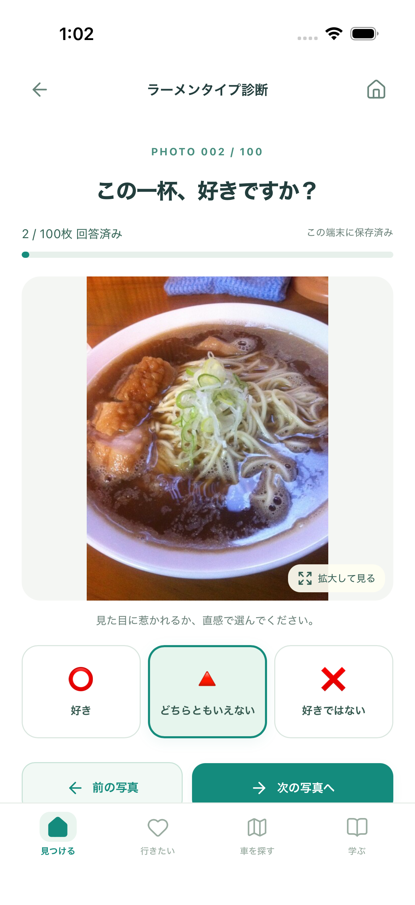

# ラーメンタイプ診断の確認記録

関連：Issue #122。ホームから診断を開き、回答・結果確認までアプリ内で操作します。起動・保存・元データとの対応は[実装ガイド](../../RAMEN_DIAGNOSIS.md)を参照してください。

## 画面

| ホーム入口 | 説明・開始 | 写真と3択 |
| --- | --- | --- |
|  |  |  |

| 結果 | 4軸の比較 |
| --- | --- |
|  |  |

390px幅の画面です。結果画像は○・×・△を順番に繰り返したテスト回答から生成しており、本人の好みや正解例を示すものではありません。「寄り」は境界のある暫定タイプです。

## 人間が確認する3操作

1. ホームの「ラーメンタイプ診断」を開き、3種類の回答と写真拡大を試す。写真の見やすさとボタンの押しやすさを確認します。
2. ホームへ戻って再読込し、診断を再開する。前の写真に戻って、選んだ回答が残っていることを確認します。
3. 100枚終了後の説明・バー・回答写真を見て、意図した診断になっているか確認します。全て△ならタイプ保留になります。

## 開発側の確認

- 型チェック・ビルド・整形：成功。
- PC／スマホのChromium、スマホのWebKit：診断・既存保存・ナビゲーションの81ケース成功。
- 元の採点との比較：完了41通り＋途中6通りで全結果が一致。完了分は書き出しテキストも一致。
- 問題・特徴定義・100枚の写真の同一性を検査。参照元のファイルが変わっていないこともSHA-256で確認。
- iPhone 17シミュレーター（iOS 26.5）：実際のWKWebViewで写真へ回答し、アプリ終了・再起動後に3枚目から再開。2枚目に戻り、選んだ△が残っていることをXCTestで確認。専用端末で実施し、利用中の端末データには触れていません。
- 初回のシミュレーター起動待ちと、iOSが問題番号を別々のテキスト要素として認識する点に合わせ、テスト側の待機・確認対象を修正した後に成功。

全体CIの結果はPR #123・Issue #122に記録します。実機iPhoneの長時間操作・共有先への保存は未確認です。

外部API呼び出し・新たな公開・診断回答の外部送信は行っていません。既存の保存内容に診断の回答が追加されます。
