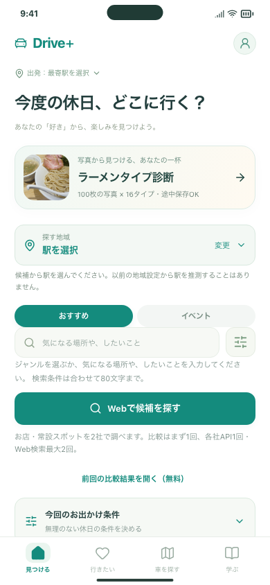
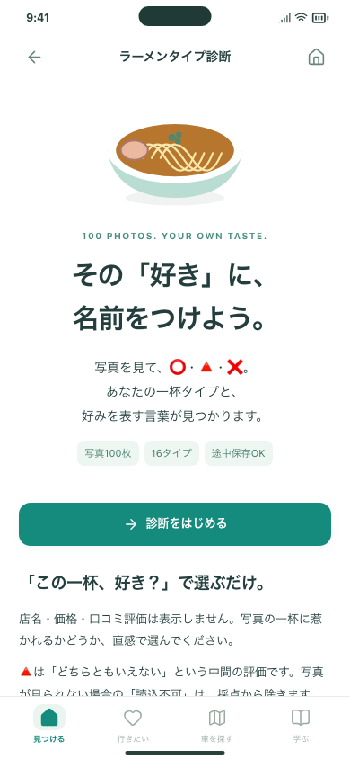
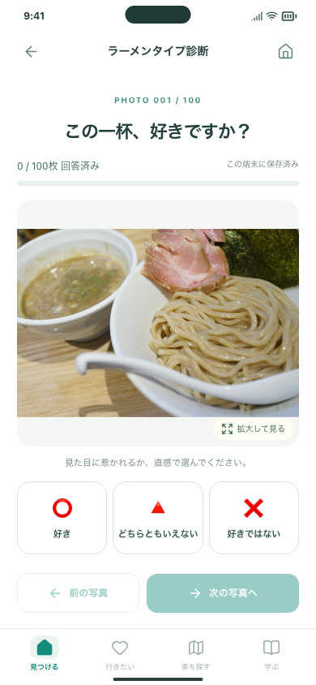
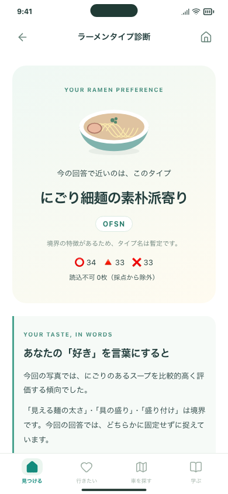
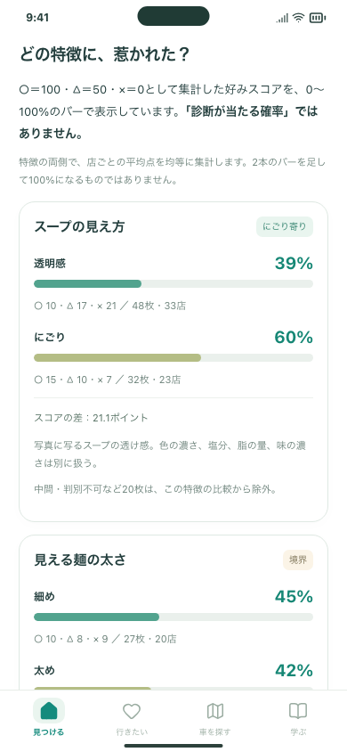

# ラーメンタイプ診断の確認記録

関連：Issue #122。ホームから診断を開き、回答・結果確認までアプリ内で操作します。起動・保存・元データとの対応は[実装ガイド](../../RAMEN_DIAGNOSIS.md)を参照してください。

## 画面

| ホーム入口 | 説明・開始 | 写真と3択 |
| --- | --- | --- |
|  |  |  |

| 結果 | 4軸の比較 |
| --- | --- |
|  |  |

390px幅の画面です。結果画像は○・×・△を順番に繰り返したテスト回答から生成しており、本人の好みや正解例を示すものではありません。「寄り」は境界のある暫定タイプです。

## 人間が確認する3操作

1. ホームの「ラーメンタイプ診断」を開き、3種類の回答と写真拡大を試す。写真の見やすさとボタンの押しやすさを確認します。
2. ホームへ戻って再読込し、診断を再開する。前の写真に戻って、選んだ回答が残っていることを確認します。
3. 100枚終了後の説明・バー・回答写真を見て、意図した診断になっているか確認します。全て△ならタイプ保留になります。

## 開発側の確認

元の採点プログラムとの全結果比較、写真・問題の同一性、100問のUI操作、読込エラー、端末保存・既存画面への影響を自動テストします。実行結果・CI・iPhoneシミュレーターの結果はPRとIssue #122に記録します。

外部API呼び出し・新たな公開・診断回答の外部送信は行っていません。既存の保存内容に診断の回答が追加されます。
