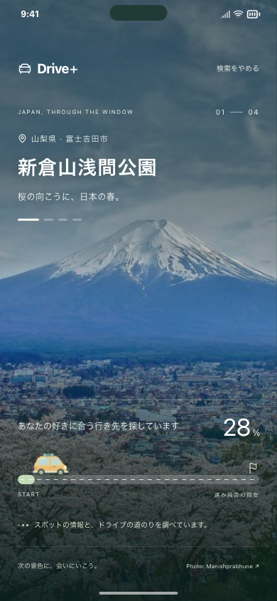
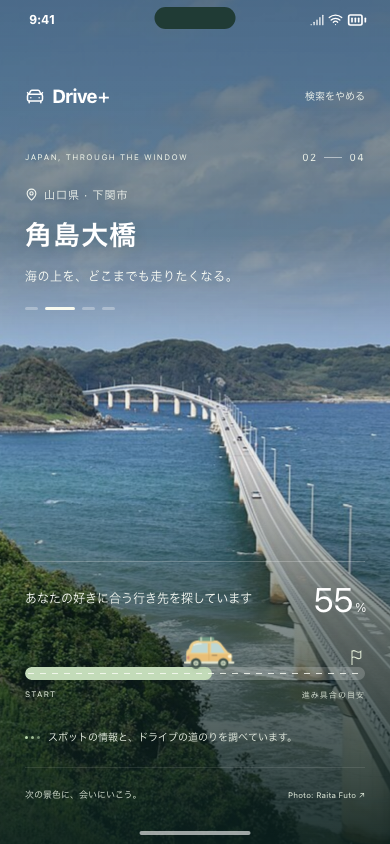
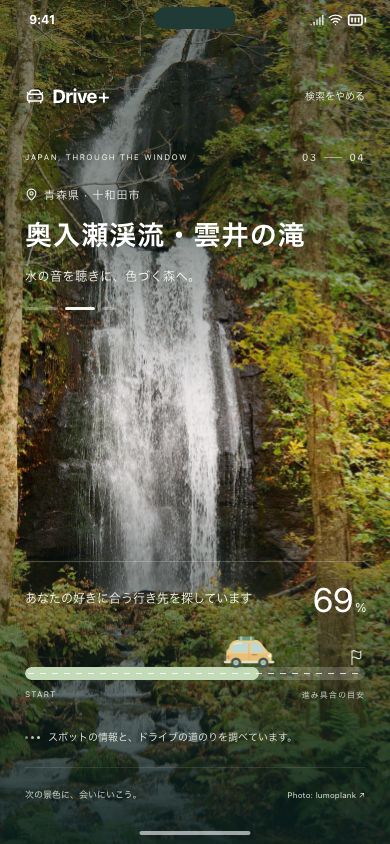
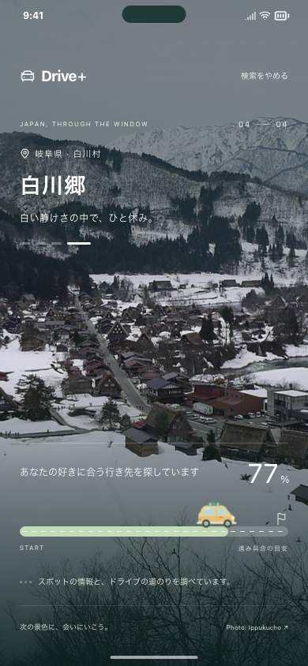
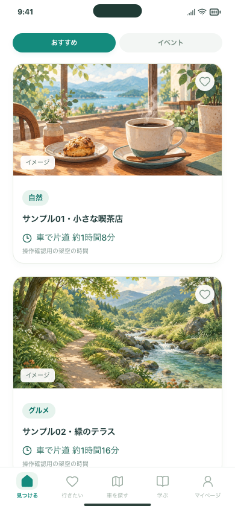

# 趣味設定から、写真を眺める検索待ち画面へ（#133）

趣味設定の「ドライブ先を見つける」を押すと、日本の観光地の写真が全面に広がる画面で現在地取得と検索を待ちます。候補を受け取って検査し終えたら100%を表示し、約1.1秒後にパネルが並ぶホームへ移ります。ホームに入るための追加検索はありません。

## 試す3操作

現在のMacの確認URL： http://127.0.0.1:5211/#/onboarding/1

1. 趣味を選び、「ドライブ先を見つける」を押します。写真、左上の地名とコメント、下部の車と進捗が表示されます。位置情報の確認が出たら選択します。
2. 検索が完了すると100%になり、ホームの「おすすめ」の下にカードが並びます。カードを押すと従来どおり詳細を確認できます。
3. 位置情報を許可しない場合は「駅を選んで探す」から駅を選び、「この駅から探す」で再開できます。通信失敗や候補ゼロの場合も、自分で再試行できます。

趣味設定の「スキップ」は趣味を限定せず同じ待ち画面へ進みます。Welcomeの「まずは見てみる」と、設定済みの利用者が直接ホームを開く際の動作は従来どおりです。ホーム内の手動検索に、この全面画面は追加していません。

## デザインと進捗

- 承認済みHTMLから、富士山・角島大橋・奥入瀬渓流・白川郷の4枚、地名・コメント、黄色い車を移植しました。写真は7.5秒ごとに切り替わります。
- 写真は同梱素材です。出典ボタンで撮影者・ライセンスを確認でき、写真は検索結果や現在の現地の様子を表さない旨を説明しています。
- 現在地取得、接続、順番待ち、検索、結果確認は実際の処理状態に対応します。処理中の数値は段階内で動く目安であり、実処理件数の割合ではありません。画面にも「進み具合の目安」と表示します。
- 時間経過だけでは100%になりません。候補ゼロ・エラーは成功扱いせず、再試行画面に止まります。件数や検索時間も保証しません。
- 検索停止・画面離脱後の遅い応答は無視します。自動再試行を追加していません。出典シートを開いている間は、自動遷移を保留します。
- 写真の読み込み失敗時も検索は継続します。端末・アプリの「動きを減らす」設定に従います。

### 画面例（無料の固定応答による確認）

| 富士山 | 角島大橋 |
| --- | --- |
|  |  |

| 奥入瀬渓流 | 白川郷 |
| --- | --- |
|  |  |

| 応答完了後の100% | 遷移先のホーム（架空サンプル） |
| --- | --- |
|  |  |

## 動作確認

2026-11-03、Node.js 24.20.0 / npm 11.19.0。

- `test:discovery-search`：153件成功。新しい待ち画面の24件を含み、PC幅Chromium・iPhone幅Chromium・iPhone幅WebKitで確認しました。固定応答を60秒保留しても100%にならず、応答後に100%→10カード、ホーム再入場で追加POSTなし。
- 新規24件ではGPS拒否→駅で再開、通信失敗・候補ゼロ→明示再試行、GPS取得中・検索中のキャンセルと遅い応答の無視、画像失敗、動きを減らす設定、写真の出典、趣味設定を明示的に開き直した場合を確認しました。
- 既存の出発地・自由記述・気分・イベント検索、保存、設定リセット、バックグラウンドからの復帰も上記検索テストに含みます。
- 通常の静的ビルドのブラウザテストでは534件成功。残る配信復旧3件は、コミット済みのクリーンビルドを要するため、コミット後に別途実行します。
- 整形、型チェック、アプリと掲載情報レビュー用のビルド、静的配信物検査も実行しました。掲載情報レビュー画面の54件も成功しました。コミット後のCI結果はPR/Issueに記録します。

### 実APIの確認

Brave Search + Gemini + Google Routesに接続した5211番で、隔離したブラウザから1回実行しました。実際の利用者の現在地ではなく、新宿駅付近の公開座標をテスト用に指定し、自然・グルメを選択しています。

- 検索POST：1回、HTTP 200。接続先は `demo: false`、`searchProvider: brave`。Geminiのレポートはcompleted。
- 10カードを表示し、10件とも取得した片道時間を表示。画面内のJavaScript例外なし。
- サーバー側実行記録7.450秒、操作からホーム表示まで約8.7秒。今回1回の測定であり、30秒以内を保証するものではありません。
- [測定記録](live-check.json)、[検索中](live-search-start.png)、[完了時](live-search-complete.png)。ホームの記録画像は遷移直後のフェード中ですが、カード数と所要時間はDOMでも確認しました。

## 費用・保存・外部送信

既存の現在地・趣味を使う検索を、初回ホームの前に実行します。背景写真とアニメーションにAPI利用はなく、写真約2.1MBをアプリに追加しています。ホーム移動時に同じ検索を繰り返しません。新たな試行では既存の検索・経路APIの費用が発生し、すでに送信したリクエストは途中停止しても料金が発生する場合があります。

新しい保存項目はありません。趣味と初期設定完了は既存方式で保存し、進捗と未保存の結果・GPSはセッション内で扱います。GPSや所要時間を新たにlocalStorageへ書き込まず、送信先・送信内容・キーの扱いも既存検索から変更していません。

公開Webへの配信、インストール済みiPhoneへの反映、実機Safari・iOSでの検証は今回未実施です。検索先を接続していない通常の静的プレビューでは、理由とホームへの戻り方を表示します。

## 実装と依存

`SearchJourney.tsx` が新しい画面、`searchJourney.css` が画面内に限定した装飾です。`WebSearchState.tsx` で既存検索の段階、初回開始、駅での再試行とキャンセルを扱い、結果を同じProviderのままホームへ引き継ぎます。採用する候補、趣味配分、時間範囲1〜5時間、検索プロンプトは変更していません。

Issue #133。土台はBrave Search追加のPR #132（`codex/issue-131-brave-search`）です。写真の出典・ライセンスは[画像素材](../../ASSETS.md)、[配布素材の取得記録](../../../public/images/search-journey/sources.json)を参照してください。
