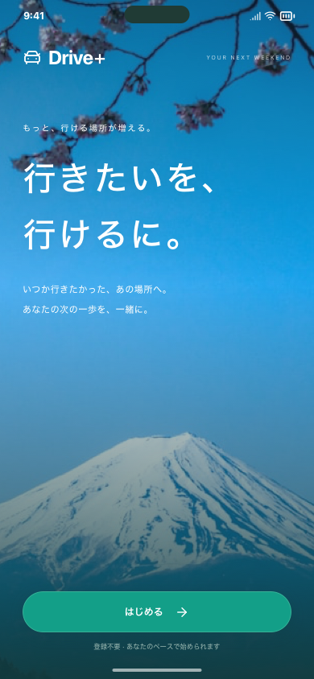
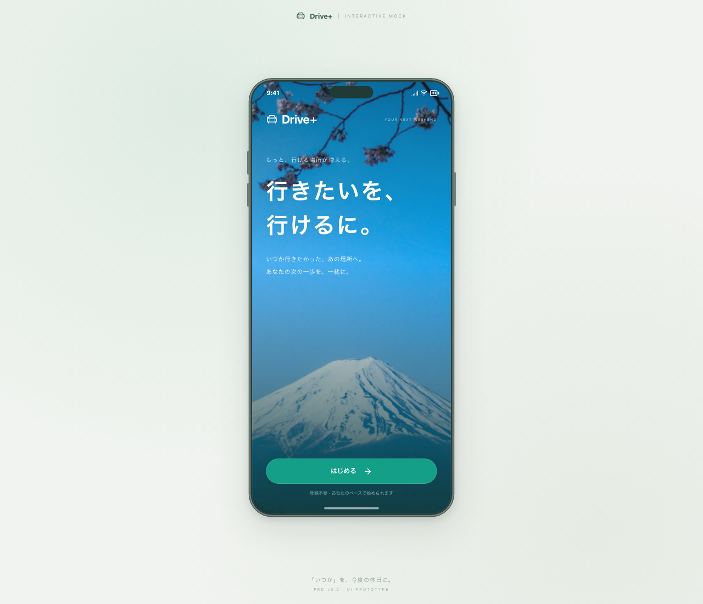

# 開始画面を「はじめる」に統一

開始画面の「まずは見てみる」ボタン、専用の余白・スタイル、初期設定を飛ばす処理を削除しました。「はじめる」→趣味設定→検索の流れは維持しています。趣味設定内の「スキップ」は別の操作なので変更していません。

## 確認操作

1. `#/welcome` を開くと、開始画面の操作ボタンは「はじめる」だけです。
2. 「はじめる」を押すと趣味を選べます。一度戻って入り直しても選択は残ります。

PC幅のChromiumとスマートフォン幅のWebKitで上記操作と横はみ出しがないことを確認しました。型チェック・ビルド・整形も成功しています。既存の初期設定、キーボード移動、保存保護、静的配信のテストを確認しています。最終結果はPRのCIに記録します。

開始画面に依存していた既存テストは、初期設定済みのデータを用意する共通ヘルパーに切り替えました。初期設定自体の操作テストはそのまま残しています。撮影・地図計測スクリプトは確認対象画面を直接開きます。

保存データと検索処理は変更していません。今回の画面確認では外部API呼び出し0件、追加課金なしです。公開配信・iPhone実機反映は行っていません。

関連: Issue #139。前提: PR #138。
